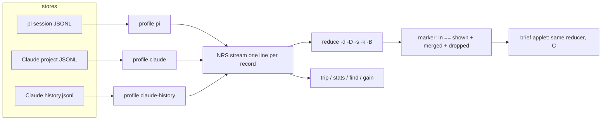

`src/miscutils/brief.c` reduces line-oriented output by counting records and never editing one; a sibling repository at `~/src/nrs` (spec `NRS.md`, `schema=1`) applies the same rule to conversation stores, so the next step for the applet — a `--from-profile` that feeds JSONL through the existing reducer — has a written grammar and measured numbers instead of a guess.

## What the sibling repository adds

- **The record grammar:** `kind TAB time TAB dur TAB status TAB subject TAB payload`, base36 seconds/milliseconds, and `:` TAB body lines that carry no other prefix. A body line earns nothing from a repeated prefix: 2.79 M body lines at 20 bytes each would be 56 MB of duplication.
- **Profiles as data:** `profiles/{pi,claude,claude-history,generic}.nrs` map a producer's keys onto those six fields, so a new tool is a text file rather than a patch. Only content-block arrays (`text`, `thinking`, `tool_use`, `tool_result`, `image`) are handled in code, because every harness emits them.
- **A loss ledger that closes:** on 613 files / 2.69 GB this laptop holds, `nrs gain` accounts for every byte — 598 MB wire capture, 680 MB base64 tool output, 759 MB duplicated `toolUseResult`, 415 MB JSON envelope — and the sum equals the raw size exactly.

## Measured on this machine

| layer | pi (340.6 MB) | Claude (2,344.1 MB) | all (2,685.1 MB) |
|---|---|---|---|
| identity NRS | 112.7 MB (33.1%) | 64.4 MB (2.7%) | 177.2 MB (6.6%) |
| `-D -s` dedupe | 53.8 MB (15.8%) | 44.3 MB (1.9%) | 95.2 MB (3.5%) |

59% of all body lines are repeats of a line already in the stream once digit runs are masked, which is the same result as `docs/discoveries/for-shrinking-a-string-set-aggregation-beats-token-minimization.md`: aggregation and counting beat token minimization, and the `brief` reducer is the counting half.

## Two things not in the applet today

`ENABLE_FEATURE_PREFER_APPLETS 0` and `ENABLE_FEATURE_SH_STANDALONE 0` are unchanged, so none of this chains in-process inside busybox; a profile-reading `brief` must be one applet doing its own JSON reading (`libbb/json_read.c` exists for exactly that).

