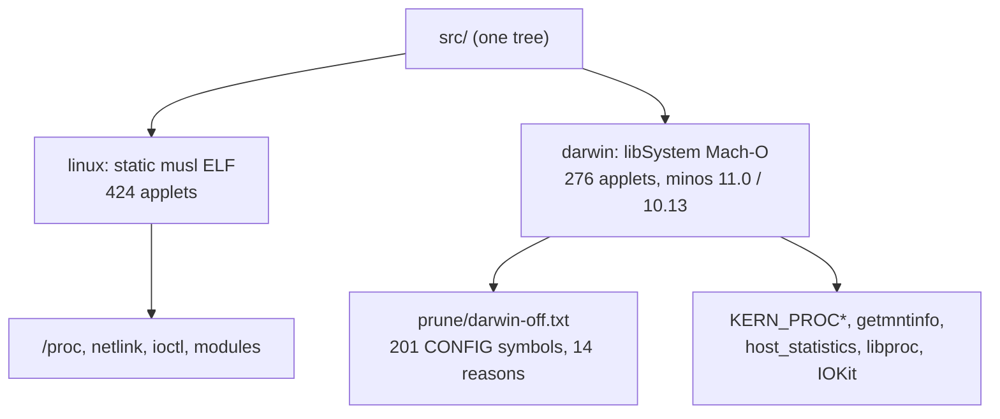

The same source produces both binaries; what differs is the backend behind the POSIX surface, not the interface. Linux ships **424 applets** as a static musl ELF, Darwin ships **276** as a libSystem Mach-O, and every one of the 148 missing applets is missing for a Linux-ABI reason recorded in `prune/darwin-off.txt`. The agent-facing applets added by this tree behave identically on both, and the test suites prove it with the same numbers.



## The counts

| | linux-arm64 | darwin-arm64 | why |
|---|---|---|---|
| applets | 424 | 276 | 148 pruned, none added |
| link | static ELF (musl) | Mach-O, `libSystem` + optional `libresolv`/`IOKit`/`CoreFoundation` | Apple ships no static libc |
| floor | any kernel | minos 11.0 arm64 / 10.13 x86_64 | `-mmacosx-version-min` or the SDK stamps minos |
| `-pure` variant | n/a | drops `nslookup`, `iostat`, `lsblk` | leaves `libSystem` as the only dylib |
| verification | `./tests/*.sh` in a container | `./tests/*.sh` natively | identical results |

## Why 148 applets are absent

`prune/darwin-off.txt` carries 201 symbols under 14 headings; the biggest:

| symbols | reason |
|---|---|
| 32 | block devices / filesystems only Linux can make (`mke2fs`, `fsck.minix`, `mkfs.vfat`, `blkdiscard`…) |
| 30 | mtd / i2c / watchdog / hw (`ubi*`, `i2c*`, `nand*`, `watchdog`) |
| 29 | x86 SHA-NI hardware acceleration (not applets, feature symbols) |
| 20 | networking: netlink / Linux-only ioctls (`ip` extras, `vconfig`, `ifenslave`, `brctl`) |
| 20 | shadow / directory-service account tools (`passwd`, `adduser`, `su`, `login`) |
| 11 | console / fb / input (`setfont`, `openvt`, `showkey`, `loadkmap`) |
| 11 | PF_PACKET/BPF, `adjtimex`, `__NR_*`, `init` |
| 8 | /proc-based process tools (`pmap`, `smemcap`, `taskset`) |
| 6 + 6 + 5 | init/reboot, kernel modules, runit supervision |

The rule: if the implementation calls a Linux-only syscall or reads `/proc`, it is pruned rather than stubbed — a stubbed `ip link set` that silently does nothing is worse than an absent one.

## Same interface, different backend

These were rewritten against Darwin APIs, not dropped:

| applet(s) | linux backend | darwin backend |
|---|---|---|
| `ps`, `pgrep`, `pkill`, `killall`, `pidof`, `top`, `mpstat`, `vmstat` | `/proc` | `KERN_PROC_ALL` + `KERN_PROCARGS2` |
| `df`, `mount`, `umount` | `getmntent` | `getmntinfo` + APFS firmlink matching |
| `free`, `uptime` | `/proc/meminfo`, `/proc/uptime` | `host_statistics`, `sysctl` |
| `fuser` | `/proc/*/fd` | `libproc` |
| `iostat` | `/proc/diskstats` | IOKit |
| `nslookup` | `libresolv` symbols | `res_9_*` exports |
| `iostat`/`lsblk` | n/a | IOKit, hence absent from `-pure` |

## Differences an agent will actually hit

- **`pgrep -x` never matches on Darwin.** The walker hands back a pre-joined argv (`"sleep 20"`), so whole-name comparison fails. Use `-f '^name '`. `pkill -x` therefore exits 1 and kills nothing.
- **`comm` is the multicall binary**, and macOS truncates to 15 chars, so every applet process shows as `busybox`. Match on argv, never comm.
- **`stat` takes `-c fmt`**, not BSD `-f fmt`; `stat -f '%m %z' file` errors because `-f` is the filesystem mode.
- **There is no `/proc`.** Anything that assumed it (`ps` row counts in tests, `/proc/self/exe`) needs a fallback; `bb_busybox_exec_path` is `/proc/self/exe` even on Darwin.
- **Under Rosetta** a script's comm is the interpreter, so pidof/killall miss scripts there.

## The agent-facing applets are the same on both

`run`, `log`, `peek`, `replace`, `waitfor`, `why`, `json`, `patchcheck`, `bench`, `snapshot`, `check`, `brief`, `column` come out of the same `.c` file with no `#ifdef`-per-platform behaviour, and the four suites return comparable numbers:

```
darwin-arm64: sweep 1253/0, deep 1036/0, brief 910/0, agent-ops 1299/0
linux-arm64:  sweep 1253/0, deep 1036/0, brief 910/0, agent-ops 1318/0
```

The 19-check gap in `agent-ops` is fixture availability (`python3` for Zip64, APFS-only `stat`), not behaviour.

## Verifying a difference yourself

```sh
# applet sets
build/deep-darwin/busybox --list | sort > /tmp/d
docker run --rm -v "$PWD:/w:ro" almalinux:9 sh -c 'w/build/deep-linux-arm64/busybox --list | sort' > /tmp/l
comm -13 /tmp/d /tmp/l          # linux-only
comm -23 /tmp/d /tmp/l          # darwin-only: empty

# link and floor
otool -L build/deep-darwin/busybox | head -5
file build/deep-linux-arm64/busybox

# the reason an applet is absent
busybox why -C build/deep-darwin/.config -p prune/darwin-off.txt dmesg
```
