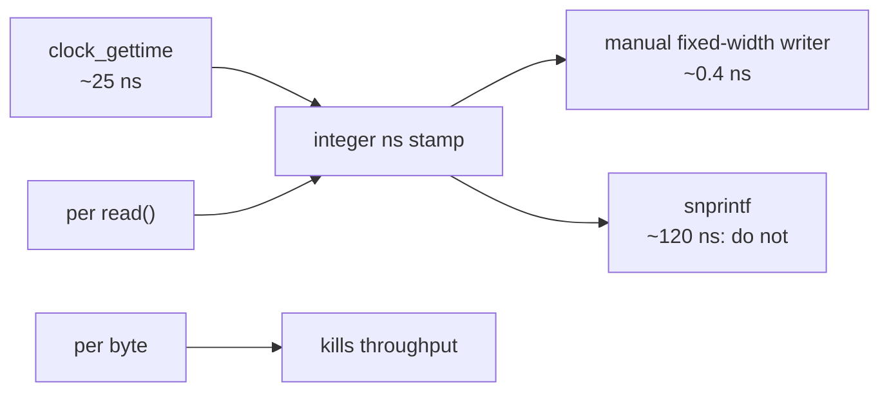

Nanosecond stamping is cheap and — on this hardware — genuinely identical across both targets: Apple Silicon and the ARM architected counter both tick at 24 MHz, so **resolution is 41 ns on darwin-arm64 and 41 ns on linux-arm64**, a clock read costs ~25 ns, and the real cost is the formatting, not the clock. The advice is to put one `bb_monotonic_ns()` in libbb, stamp per read() rather than per byte, and hand-write the digits.



## Measured here, both platforms

| metric | darwin-arm64 | linux-arm64 |
|---|---|---|
| resolution | **41 ns** | **41 ns** |
| clock read | 23.8 ns | 26.5 ns |
| format with `snprintf` | 111.5 ns | 123.6 ns |
| format by hand | 0.4 ns | 0.4 ns |

Linux container reported clocksource `arch_sys_counter`. Apple's timer is 24 MHz (41.67 ns/tick) — the same tick as the ARM architected counter, which is why the two agree. **ns digits are nearly free; printing them is not.** A 9-digit field on a 41 ns counter means the last 1.5 digits are quantisation, so declare the resolution rather than implying precision.

## Design

- **One clock, in libbb.** New `libbb/clock_ns.c` with `bb_monotonic_ns()` (and a lazily measured `bb_clock_resolution_ns()`), so applets never see a `#ifdef` — the §6.3 rule for platform shims.
- **Pick the clock deliberately on Apple.** `CLOCK_MONOTONIC` stops during sleep, `CLOCK_MONOTONIC_RAW` keeps counting from the boot tick; they have *different bases*, so choose one per timeline and never mix. On Linux `CLOCK_MONOTONIC` (vDSO) is the right default. `clock_gettime_nsec_np(CLOCK_UPTIME_RAW)` is macOS-10.12+ only and unnecessary given minos 11.0.
- **Never `CLOCK_REALTIME`** for stamps: NTP steps and manual clock changes turn a sorted timeline into a lie. Keep the wall-clock origin as a single separate field (`started_unix_us`) for correlating with other logs.
- **Stamp at the read() boundary, not per byte.** One read() can carry many lines; giving each its own stamp fabricates precision. Emit the stamp on the first line of a read and mark the rest as sharing it (a `~` in the stream column or a `same=1` field), which is the same honesty already applied to cross-stream ordering.
- **Hand-write the field.** `snprintf` costs 100× the clock read; a manual fixed-width writer costs nothing measurable. Buffer the line and `full_write` it.
- **Declare the resolution.** One `stamp_res_ns=41` in the header and `"stamp_res_ns"` in JSON lets a consumer know what the last digit means, and makes the two platforms provably alike.

## Gotchas that bite in practice

- A container's `CLOCK_MONOTONIC` is the **host's**, so stamps correlate with host boot, not container start.
- In a VM the TSC may be scaled or unstable; ns is not a promise, it is a reading. `arch_sys_counter` and Apple's timer are stable; a virtualised x86 TSC may not be.
- Do not add `tv_nsec` values directly — always go through the `sec*1e9 + nsec` split, or you will produce unnormalised timestamps on one libc and not the other.
- Take the stamp *before* formatting and keep the integer; formatting can take longer than the interval you are measuring.
- `-pure` builds must stay `libSystem`-only: `clock_gettime` and `mach_timebase_info` are both in libSystem, so this adds no dylib.

## How to verify it, not assume it

```sh
# resolution: smallest positive delta between two reads
# (41 on both here; anything >100 ns means a coarse clocksource)
cat /sys/devices/system/clocksource/clocksource0/current_clocksource   # linux
busybox doctor --build -F json | grep -o '"clock[^,]*'                 # once wired
```

Then assert in the suites: `stamp_res_ns <= 100` on both, a million consecutive stamps are non-decreasing, and the stamp field's regex is byte-identical across platforms. The existing `tests/agent-ops-sweep.sh` §24-25 already asserts the field shape and monotonicity for the µs form — extend the same checks with `--stamp-ns` rather than writing a new suite.
