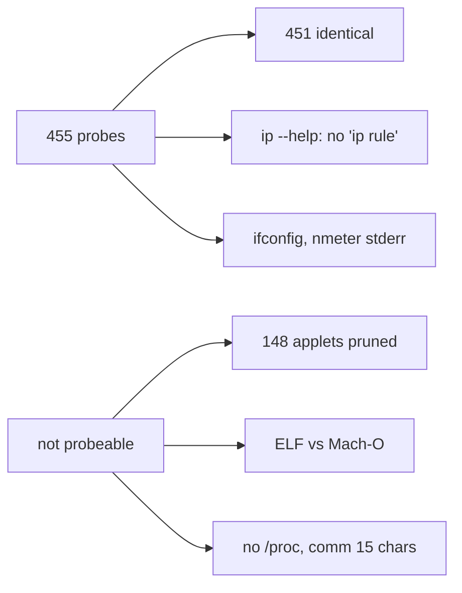

Fresh audit against both binaries: **451 of 455 probes are identical**. Four rows differ, and all four are capabilities or libc wording — none is a bug. Everything else that differs cannot be probed at all, because it is the applet set, the link, or the kernel.



## The four remaining probe differences

| probe | darwin | linux | why |
|---|---|---|---|
| `ip --help` | one line shorter | includes `ip rule [list] \| add\|del SELECTOR ACTION` | `FEATURE_IP_RULE` is netlink-only and pruned; `ip rule` genuinely does not work here |
| `ifconfig --nosuchopt-zz` | `--nosuchopt-zz: error fetching interface information: Operation not supported by device` | `--nosuchopt-: error fetching interface information: Device not found` | same shape and same exit 1; getopt consumes the token differently and `strerror(ENODEV)` is libc-specific |
| `nmeter --nosuchopt-zz` | `can't change directory to '/proc'` | `unrecognized option: …` | no `/proc` here, so it fails before parsing |
| one probe | — | — | excluded: killed by the timeout on one side |

Run it yourself:

```sh
(nohup ./tests/platform-probe.sh build/deep-darwin/busybox > /tmp/d.probe 2>/dev/null &)
(nohup docker run --rm -v "$PWD:/w:ro" almalinux:9 \
	bash /w/tests/platform-probe.sh /w/build/deep-linux-arm64/busybox > /tmp/l.probe 2>/dev/null &)
./tests/platform-diff.sh /tmp/d.probe /tmp/l.probe
```

The 254 "only in B" rows are the extra 148 Linux applets' probes — expected, not differences.

## What no probe can see

- **Applet set**: 424 linux, 276 darwin, **0 darwin-only**, 148 pruned by `prune/darwin-off.txt` (201 CONFIG symbols). `busybox why -C … -p prune/darwin-off.txt NAME` answers any single case.
- **Link**: static musl ELF vs Mach-O against `libSystem` (+`libresolv`/`IOKit`/`CoreFoundation` unless `-pure`); minos 11.0 arm64 / 10.13 x86_64.
- **Process layer**: no `/proc`, so `ps`/`pgrep`/`killall`/`pidof` read `KERN_PROC_ALL`+`KERN_PROCARGS2`; `comm` is `busybox` and macOS truncates it to 15 chars; under Rosetta a script's comm is the interpreter.
- **Clock**: `CLOCK_MONOTONIC_RAW` on Darwin for the 41 ns tick (its `CLOCK_MONOTONIC` is 1 µs quantised) vs `CLOCK_MONOTONIC` on Linux — different bases and different suspend behaviour, so never mix them in one timeline.
- **Platform strings**: `arch` is mapped to `aarch64`, but `uname -m` still says `arm64`; `stat` takes `-c` (BSD's `-f` is the filesystem mode); `/dev/hvc0` does not exist.
