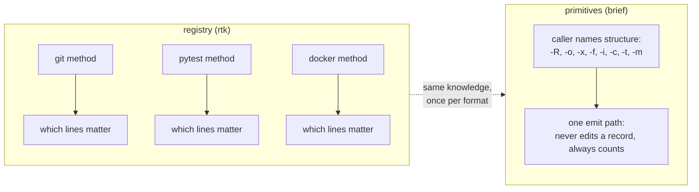

`brief` answers rtk with six orthogonal primitives and caller-supplied structure — selection (`-o`/`-x`), record boundaries (`-R`), projection (`-f`/`-i`/`-S`), grouping (`-d`/`-s`/`-c`), ordering and thresholds (`-t`/`-m`), and one bounded emit (`-B`/`-n`/`-a`) — rather than with a registry of per-format reducers. The rejected option was to ship `brief`-as-rtk: a subcommand or method table per output format (`git`, `pytest`, `docker`, `kubectl`, …) declaring which lines matter and which columns to keep.

## Why the registry was rejected

- It cannot live in this tree. `AGENT-FEATURES.md` §9 rules out state, daemons and a data registry; a method table is a data file plus per-format code in a one-file multicall binary, and §6 wants no per-platform behaviour to maintain.
- It guesses. rtk needs a *method per format* precisely because "which lines matter" is not inferable. The caller knows; `-R 'commit '` and `-o error` are that knowledge, expressed once per call instead of once per format upstream.
- It cannot stay byte-exact. rtk's `toon`/`minify-json` rewrite records, so its output is not quotable back into `grep` or `peek --around`. Every brief record is the input's bytes.
- It rots. A registry has to track each tool's output format. `-i :` covers `grep -n`, `gcc`, `mypy`, `eslint`, `psql` and anything else colon-delimited, today, with no entry.

## What the measurements decided

| case | rtk | brief | verdict |
|---|---|---|---|
| `git log -30` (18,918 B) | 9,672 B digest | 2,020 B, whole commits | brief, 4.8× smaller and byte-exact |
| `grep -rn` (36,000 B) | `rg` 14,361 B | `-i : -c 1 -t 20` 2,504 B | brief, 5.7× smaller |
| pytest log (17,137 B) | `log` 644 B (no messages), `err` 772 B | `-o FAILED` 618 B | brief: smaller and it keeps the messages |
| `ls -l` (11,129 B) | 779 B, 52/174 entries silently | 999 B, 54 entries, `truncated=1` | brief: rtk's head start is silent loss |
| wall time | `rtk ls` 70.5 ms | `ls -l \| brief` 35.7 ms | brief, one process |

Two rtk capabilities have no brief equivalent and are accepted as out of scope: a cumulative savings ledger (`rtk gain` across calls, which needs state — the marker's `in_bytes=`/`bytes=` measures one call instead), and a hook that rewrites a command before it runs (harness layer, not an applet).

## The rule this leaves behind

A format-specific reducer is a *policy*; brief ships the *mechanism* and lets the caller state the policy in the invocation. That is why a new tool needs no patch, and why nothing in the applet has to know what `git log` looks like.

