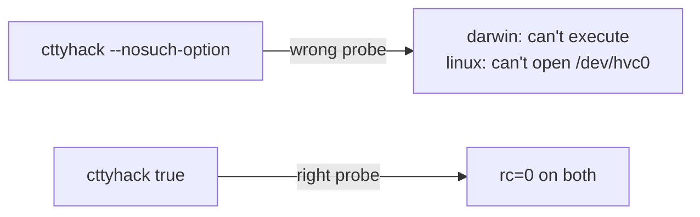

Measured with the right probe, `cttyhack` behaves the same on both platforms — `busybox cttyhack true` returns **rc=0 on darwin and rc=0 in the container** — so the "parity difference" was an artefact of feeding an applet that takes a *command* a bogus option. `tests/platform-probe.sh` no longer does that.



## The measurement

```
darwin:   busybox cttyhack true            → rc=0, no output
linux:    busybox cttyhack true            → rc=0, stderr "can't open '/dev/hvc0'"
```

The container's stderr line is true — it has no console — and both still exit 0. `src/shell/cttyhack.c` already opens the console before `BB_EXECVP_or_die`, so my earlier claim that the port "executes before opening" was simply wrong: on a terminal the fd is already valid and the open is skipped by design.

## What changed

`tests/platform-probe.sh`: `cttyhack` joins the no-option-parser group (`add-shell`, `remove-shell`, `lsscsi`, `lsusb`, `lspci`, `lsof`, `fuser`) and gets a positive probe instead — `cttyhack;runs;true` in the phase-B table. A junk option on these applets tests their argv handling, not their option surface, and produces differences that are not platform differences.

## Rule for the audit

Only probe `--nosuch-option` on applets that actually parse options. For everything else, run the applet with a valid argument and compare the exit status. The class was already known (the shell applets that write `/etc/shells`); `cttyhack` was the last member.
