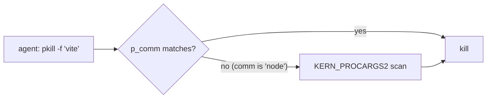

For the Darwin process layer (`killall`, `pidof`, `pgrep`, `pkill`), match on **argv — the full command line — not on `comm`**. `comm` stays only as a cheap pre-check.

## Why argv

* **`comm` is truncated.** Linux `TASK_COMM_LEN` is 16 bytes and Darwin's `kinfo_proc.p_comm` is 16 too, so the name is at most 15 characters. Every agent-started dev server collapses to `node`, `python3`, `ruby`, `deno` — indistinguishable from each other, and impossible to match on the script path at all.
* **Agents know the command line, not the process name.** The canonical idioms in agent output are `pkill -f "vite"`, `pgrep -f "http.server"`, `kill $(pgrep -f server)`. `-f` means full command line in `pgrep`/`pkill`; a Darwin port that only matched `comm` would make the most-used form unusable while appearing to work.
* **It matches what Linux busybox already does.** `libbb/find_pid_by_name.c` documents three sources — `/proc/PID/stat` comm, `/proc/PID/cmdline` argv, and the `exe` symlink — and `pgrep -f` scans cmdline. Matching argv on Darwin is the choice that keeps the two platforms' behaviour equal.

## What to implement

1. `sysctl(CTL_KERN, KERN_PROC, KERN_PROC_ALL)` gives `kinfo_proc` (pid, ppid, uid, `p_comm`) in one call — enough for `killall`/`pidof` and for the fast-reject path.
2. `sysctl(CTL_KERN, KERN_PROCARGS2, pid)` returns argc then the NUL-separated argv — the argv scan for `pgrep -f`/`pkill -f`.
3. Keep the semantics split the tools already have: `killall`/`pidof` = `comm` (that is what they mean on Linux), `pgrep -f`/`pkill -f` = argv, plain `pgrep`/`pkill` = comm.

Note that `p_comm` is 16 bytes, so compare with `strncmp(name, comm, 15)` when matching a longer name — otherwise a 20-character program name silently never matches.
