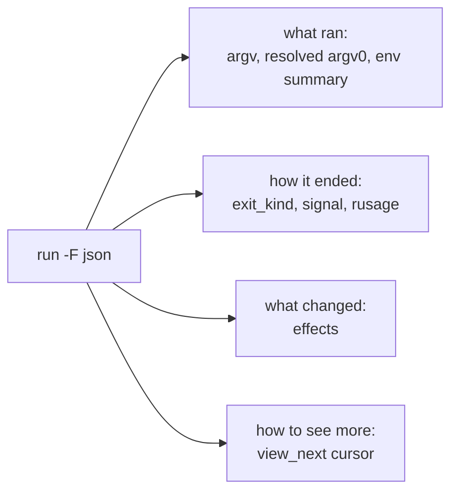

A model reading a `run` result has to answer three questions: *what actually executed*, *how it ended*, and *what changed*. Today's JSON answers the middle one worst — a signalled child reports `"exit_code":-1` with nothing else, even though `m.term_sig` is already computed and written to the meta artifact.

## Ranked by decision value per byte

| # | field | why | cost |
|---|---|---|---|
| 1 | `exit_kind` (`exited`/`signalled`/`timed_out`/`cancelled`/`spawn_failed`), `signal`, `signal_name` | `-1` and `137` are read as program errors; `m.term_sig` already exists | 5 lines |
| 2 | `argv[]` and `argv0_resolved` | `cmd` is space-joined, so quoting and argument boundaries are lost; "which python" is the most common wrong assumption | small |
| 3 | `env` summary: `inherited`, `count`, `path0`, `lang`, `tmpdir`, `home`, `user` | PATH's first entry and LANG explain most works-on-my-machine; never the whole environment | small |
| 4 | `effects[]` (`--effects`, opt-in): `{path, op, size}`, `effects_truncated` | turns "exit 0" into evidence of what it wrote | tree walk |
| 5 | `cpu_user_ms`, `cpu_sys_ms`, `max_rss_kb` (`wait4`) | separates slow algorithm from blocked I/O, 2 GB from 20 MB | small |
| 6 | `stdout_lines`, `stderr_lines`, `dropped_bytes`, `binary`, `final_newline` | size and shape before reading; some line counts already exist in source | small |
| 7 | `replay` (exact `cd` + env + command), `inputs_hash` | lets a model re-run deterministically instead of guessing | small |
| 8 | `view_next` (`log -D DIR R17 -l 42:100`) | `view_truncated:true` currently gives no way back | 3 lines |
| 9 | `busybox_version` (+ `--caps` hash) | attributes a result to a specific build | 2 lines |

Deliberately excluded: a per-call explanation of exit codes (belongs in the model's head or the docs, not in bytes), and a full environment dump (secrets, size, and no signal).

## Rule for adding any of these

Additive only, per `BUSYBOX-CONTRACT.md` §7: new keys never change an existing one, and every new count needs a companion `*_truncated` or `*_known` flag so absence is never mistaken for zero.
