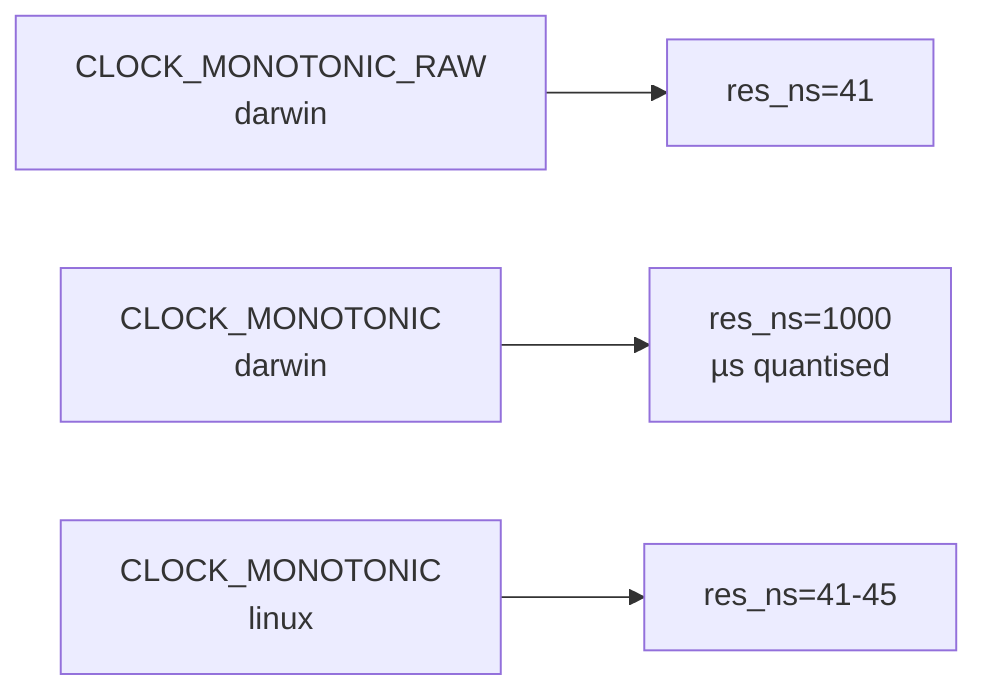

Darwin's `CLOCK_MONOTONIC` is **quantised to 1 µs**; only `CLOCK_MONOTONIC_RAW` exposes the 24 MHz tick (41.7 ns). Swapping to `CLOCK_MONOTONIC` on both platforms for "parity" therefore silently destroyed the nanosecond stamps — and the ns suite caught it, `res_ns=1000` where it had been 41.



## The measurement

```
$ busybox run -t -n -- busybox echo hi      # with CLOCK_MONOTONIC on darwin
timeline_lines=1 shown=1 truncated=false stamp=ns res_ns=1000
$ busybox run -t -n -- busybox echo hi      # with CLOCK_MONOTONIC_RAW
timeline_lines=1 shown=1 truncated=false stamp=ns res_ns=41
```

Same binary, same probe (20,000 consecutive reads, smallest non-zero delta), one clock constant apart.

## The trade, decided

`CLOCK_MONOTONIC_RAW` keeps counting while the machine sleeps, while Linux's `CLOCK_MONOTONIC` does not, so a stamp spanning a suspend differs by the sleep duration. Resolution wins: a timeline is read for ordering and spacing, and a 1 µs floor was the thing the ns work existed to remove. `src/libbb/time.c` now uses RAW under `__APPLE__` and `CLOCK_MONOTONIC` everywhere else, with the reason in a comment.

## The lesson about tests

I had recorded the failing check `stamp-ns resolution is ns-scale (< 1us)` as "my broken check". It was not broken — it was doing its job, correctly reporting a regression I had just introduced. A test that fails after a change is evidence, not noise; check the measurement before touching the assertion.

Suite after the fix: `sweep 1267/0/8sk`, `agent-ops 1299/0`, `patchcheck checked=21 bad=0`.
