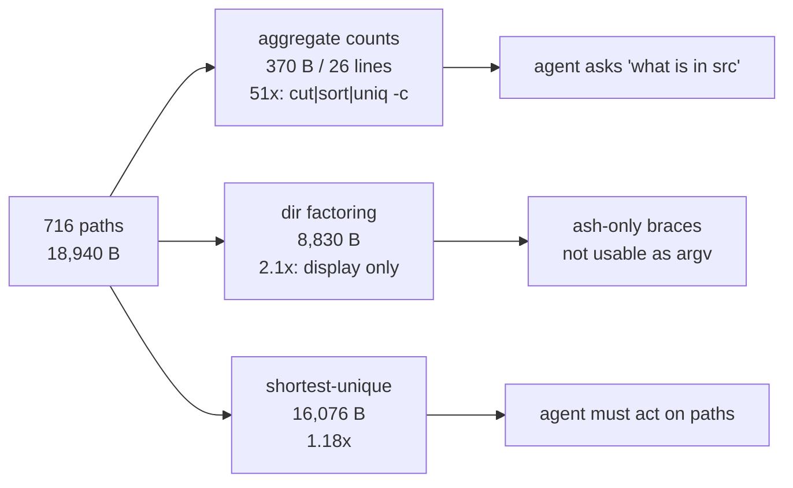

Before designing any applet that "reduces a set of strings" for an agent, know that summarization wins by an order of magnitude and token-level reduction barely pays. Measured on this tree: `fd -e c . src | sort` is 716 paths, 18,940 bytes.

## Measured representations of the same 716 paths

| form | bytes | lines | vs raw |
|---|---|---|---|
| raw full paths | 18,940 | 716 | 1x |
| shortest-unique suffix (`applets/applets.c`) | 16,076 | 716 | 1.18x |
| prefix-factored per directory (`src/applets/{ a.c,b.c`) | 8,830 | 40 | 2.1x |
| aggregate counts (`cut -d/ -f2 \| sort \| uniq -c`) | 370 | 26 | 51x |

## Why the two middle options do not carry an applet

- Shortest-unique-path saves only 15%, because nearly every path still needs a directory component to be unique across the set.
- The factored `{a,b}.c` form is unusable as argv: only `ash` does brace expansion, so busybox applets and agent tool calls cannot consume it. It is a display artifact.
- Lexical token dedupe is already free: `tr -c '[:alnum:]_/' '\n' | sort -u`.
- `AGENT-FEATURES.md` §2 bans claiming token counts and §9 rejects exact token counts outright, so an applet named for tokens advertises what the binary cannot compute.

## Where a distinguishing-substring primitive does belong

Not standalone. The real need is selection, not compression: `check --only NAME` across 1300 checks, a unique `grep` pattern per file, an unambiguous `ps` argv match (§13 item 1 records exactly this friction). That consumer is a runner flag, not a context window. Measured signature-collapse of log lines was also marginal: 5 error lines deduped to 4 templates.
