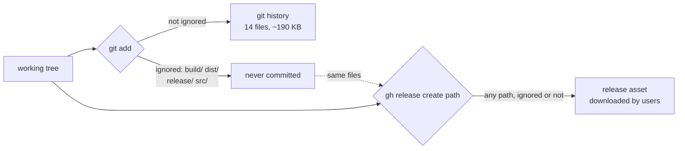

`rob-c/busybox-static` holds source, patches and scripts only — zero artifacts in git — yet build outputs are still publishable. The reason they coexist: git tracking and release assets are separate storage.

So `.gitignore` does **not** block uploads — a common wrong assumption. `gh release create` takes filesystem paths, not tree paths, so `dist/darwin-universal/bin/busybox` uploads fine while being ignored by git. Verified by attaching both a gitignored binary (1485968 B) and `release/...-src.tar.gz` (3348162 B) to a draft release.

## Repo visibility

Start private (reversible) and flip when ready; assets carry over, no re-upload:

    gh repo edit rob-c/busybox-static --visibility public

**Private repos require authentication to download release assets**, so a
private repo cannot actually share binaries. The repo was created private and
made public once the release was verified.

## Quirks

`gh release create <tag>` where the tag does not exist yet produces an **untagged** draft (URL contains `untagged-...`); `--cleanup-tag` then fails with `HTTP 422: Reference does not exist`. Harmless, but do not read it as a broken upload.

Repo stays small because `src/` (24 MB upstream clone) is ignored; the GPL source obligation is met by the attached source tarball, not by tracking upstream history.
