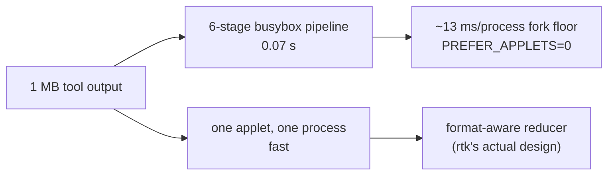

A "readable compression" stage inside busybox is fork-bound, not string-bound, and the useful version is per-format rather than generic. Measured on this Darwin box: a 6-process busybox reduction of 1 MB of tool output takes 0.07 s, while ten bare `busybox true` forks take 0.14 s — so the pipeline time is entirely process startup and the string work is free. One busybox `awk` over 40 MB takes 5.0 s (~8 MB/s).

## Why the pipeline form cannot be fast

`build/darwin-arm64/include/autoconf.h` lines 183-184 are `#undef CONFIG_FEATURE_PREFER_APPLETS` / `#define ENABLE_FEATURE_PREFER_APPLETS 0`, and lines 7275-7276 do the same for `CONFIG_FEATURE_SH_STANDALONE`. So busybox cannot chain applets in-process. "Reuse busybox's existing string tooling" therefore means forking it once per stage, which costs more than the work.

## rtk v1.2.1 is a registry of per-format reducers, not a staged text filter

`rtk` is ~30 command-bound reducers (`git`, `docker`, `kubectl`, `psql`, `aws`, `pnpm`, `dotnet`, plus `err`, `test`, `diff`, `log`, `find`), with `rtk methods list` exposing a contract per method and `rtk pipeline validate|explain|bench` to check them. Its only generic filter, `rtk smart`, is the weakest entry. The lesson is: encode what a failure *is* per format, do not guess at "key words".

## Whitespace is structure

In `/tmp/wsdemo`, `ls -l` lists both `my` and `my file.c`; after `tr -s ' '` the columns that separated them collapse and a field-counting consumer can no longer tell a filename with a space from an extra column. This is the same byte-fidelity rule as `AGENT-FEATURES.md` §2 ("odd filenames treated as bytes"). Word abbreviation fails differently: `error:`→`E` stops the text being quotable back into `peek --around` or `grep`.

## The recoverable-loss mechanism already exists

`run` captures full output to an artifact dir with a run id, and `log -B/-l/-m/-s` reads a bounded view back. Any lossy display belongs there, carrying `full=log -D DIR R<n>`, never as silent reduction of arbitrary text.
