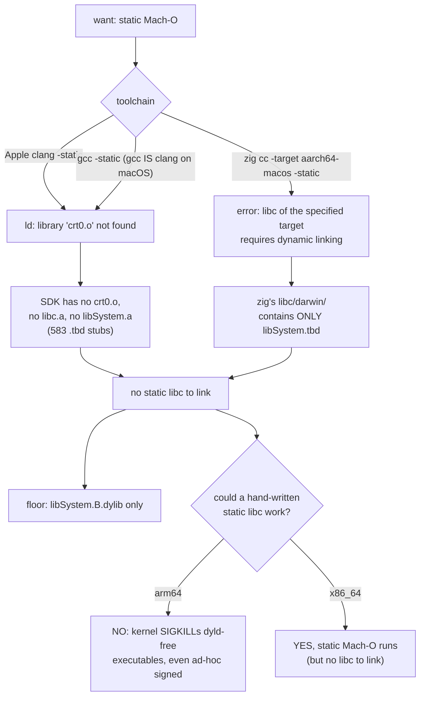

A statically linked macOS executable cannot be built, and on Apple Silicon could not run even if it were. This is not a flag, toolchain or libc choice: there is no static C library artifact for Darwin, and three independent toolchains agree.

Two traps people hit:

**`gcc` on macOS is not GCC.** `gcc --version` prints "Apple clang version 21.0.0". Installing Homebrew GCC changes nothing — it still uses Apple's `ld` and SDK.

**libc is not even a file.** `/usr/lib/libSystem.B.dylib` does not exist on disk; libSystem lives in the dyld shared cache (`/System/Volumes/Preboot/Cryptexes/OS/System/Library/dyld/dyld_shared_cache_arm64e*`). Pushing the `.tbd` at a static link yields `ld: warning: ignoring unexpected dylib` then `Undefined symbols: "start"`.

## Apple Silicon refuses static executables at runtime

Measured with a freestanding program (no libc, raw `svc`/`syscall`) linked `-static -nostdlib -Wl,-e,start`:

| binary | arch | LC_LOAD_DYLINKER | LC_CODE_SIGNATURE | runs? |
|--------|------|------------------|-------------------|-------|
| `s`    | arm64  | 0 | 1 (ad-hoc) | **no — `Killed: 9`** |
| `s64`  | x86_64 | 0 | 1 (ad-hoc) | **yes, under Rosetta** |

Both are structurally identical and both are signed, so the difference is architecture policy: arm64 macOS kills dyld-free executables. On an M-series Mac even a hand-written static libc would be refused by the kernel; only x86_64 + Rosetta could ever run one.

And a hand-written libc is itself a large project: Darwin's userland ABI needs libsystem for `__error()` (errno), `bsdthread_create`, Mach VM zones for malloc, libplatform TLS, the commpage, and `__sigtramp` for signal delivery. Shells like ash/hush need signals, so that surface is mandatory.

## The achievable floor

Link `libSystem.B.dylib` and nothing else. Achieved here with `darwin-*-pure` targets, which drop `nslookup` (the only applet needing `libresolv`); `otool -L` then lists exactly one entry. For a genuinely static busybox, use the Linux/musl build (0 `NEEDED`) under a VM or container.
