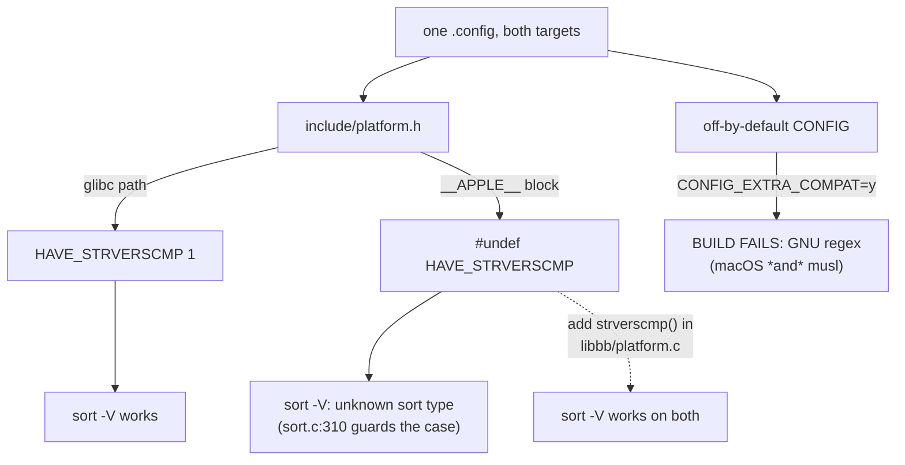

The two builds come from one `.config` that differs only for Linux-ABI applets, so most behaviour is identical by construction. The divergence that remains comes from two places — and `CONFIG_EXTRA_COMPAT` is a trap, not a win.

## 1. `HAVE_*` undefs in the `__APPLE__` block

`include/platform.h` (~line 489) undefines 13 macros for Apple. Any one that gates *behaviour* rather than performance becomes "works on Linux, fails on the Mac". Measured: `sort -V` prints `sort: unknown sort type` on Darwin and sorts correctly on Linux, because `coreutils/sort.c:310` guards the `strverscmp()` case with `#if defined(HAVE_STRVERSCMP)`. Fix is mechanical: implement `strverscmp()` in `libbb/platform.c` under `#ifndef HAVE_STRVERSCMP` (the file already holds `strchrnul`, `memrchr`, `strcasestr` this way), add its prototype next to the `#ifndef HAVE_DPRINTF`/`HAVE_MEMRCHR` block, and drop the `#if` in `sort.c`. `printf %m` (`HAVE_PRINTF_PERCENTM`) is the same story.

## 2. `CONFIG_EXTRA_COMPAT` does not build here — don't plan on it

It looks like a free `grep -z` (the `z` handling is written: `findutils/grep.c:165` option string, `:193` `OPTBIT_z`, `:225` `NUL_DELIMITED`, plus a parallel `bb_getline()`). It is not free: that path uses the **GNU regex API** (`re_compile_pattern`, `re_search`, `re_syntax_options`, `RE_SYNTAX_GREP`, `RE_TRANSLATE_TYPE`), which is glibc-only.

Measured by building out-of-tree, both with the flag flipped to `y`:

| target | result |
|---|---|
| `darwin-arm64` (`cc -arch arm64`) | **14 errors** — `unknown type name 'RE_TRANSLATE_TYPE'` … |
| `aarch64-linux-musl` (`zig cc`) | **12 errors** — same cause |

So the option is unusable in this repo, for either target. `grep -z` would need the NUL-delimited reading decoupled from the GNU-regex path and run over the normal POSIX `regcomp` path — real work, not a config flip.

## 3. `watch` is a genuine one-line win

`procps/watch.c` contains no `/proc` — it was pruned by category, not dependency. Verified: with `CONFIG_WATCH=y` the `darwin-arm64` build completes with 0 errors, produces a 752944-byte binary, `--list` reports **237** applets, and `watch -n1 "echo RAN"` re-runs on schedule (ANSI clear, expected).

## Why it matters

Either binary hands the user the same applet name, so a silent difference is worse than a missing applet. A parity harness (same corpus through `darwin-arm64` natively and `linux-arm64` under `docker run --platform linux/arm64`, diffing stdout and exit status) turns each of these into a caught test failure. Build both targets out-of-tree in `/tmp` when testing a config idea — this section exists because an untested "one-line win" was wrong.
