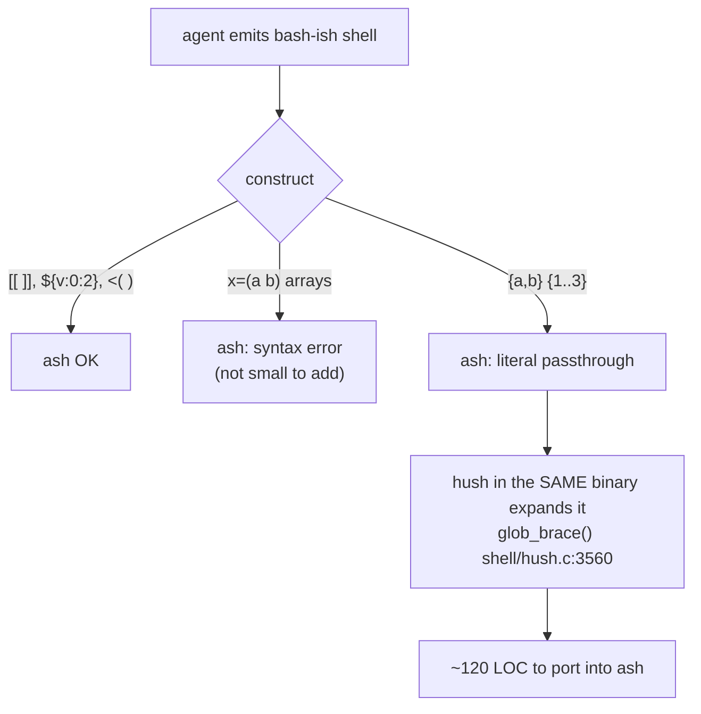

Two gaps that matter for agent-written shell code are visible only by running the binary, and one of them already has a working implementation inside it.

## `sh` is ash, and ash has no brace expansion

Measured on `dist/darwin-arm64/bin/busybox`:

* `sh -c 'echo pre{1,2}post'` → `pre{1,2}post` (literal), `sh -c 'echo {1..3}'` → `{1..3}`
* `hush -c 'echo pre{1,2}post'` → `pre1post pre2post`, and `hush -c 'mkdir -p d/{a,b}'` works
* `sh -c 'x=(a b); echo ${x[1]}'` → `syntax error: unexpected "("`

This matters because `mkdir -p src/{a,b}` / `cp f{,.bak}` are extremely common in generated commands, and they fail **silently** (the brace text becomes a filename) rather than erroring. `CONFIG_HUSH_BASH_COMPAT=y` is already set in every target here, so the algorithm (`next_brace_sub()`, `glob_brace()`) is present in-tree to port into `ash.c`; upstream has said brace expansion in ash is "not implemented right now" rather than refused.

## Also absent, cheaply measurable

* `$SECONDS` is empty in both shells; `${v^^}`/`${v,,}` are "bad substitution"; `${v:0:2}` works; `mapfile` and `declare-A` do not exist.
* No JSON tool at all (no `jq`): awk/sed JSON parsing is the documented workaround and it is fragile.
* `busybox grep -rl` over 3086 files: 0.752 s vs `rg -l`: 0.056 s — 13x.
* `tar --exclude=PATTERN` **does** work in these builds (it needs `FEATURE_TAR_LONG_OPTIONS`+`FEATURE_TAR_FROM`, and part of the web still reports it as absent).
* `sed -i` on a symlink replaces the symlink with a regular file and leaves the target untouched — same as GNU sed, so not a portability bug, but worth knowing before an agent edits a dotfile link.
* `unzip` cannot handle members ≥4 GiB: it *recognises* the Zip64 end-of-central-directory record (`archival/unzip.c:317`) only to stop reading the directory, and never parses the per-entry Zip64 extra field (`extra_len` is skipped, not decoded). So the widely reported limitation is real, and its cause is in that one function.
