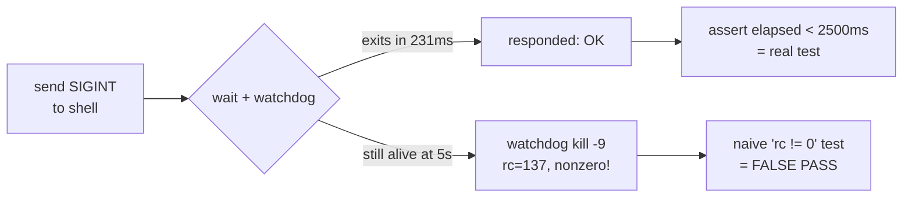

A signal test that asserts only "exit code is nonzero" is worthless: a watchdog `kill -9` also produces a nonzero code, so a hung process passes. This hid a real question in the busybox-static adversarial harness until the timing was measured.

## Assert latency, not exit status

Measure wall-clock around the wait and fail if it exceeds a budget. In `stress.sh` that is `expect_fast <name> <max_ms> <cmd>`. The internal `timeout` must be **comfortably longer** than the budget (budget + 5s), otherwise a late-but-alive process gets killed and mislabelled `HANG` instead of `SLOW` — verified with a unit check that a 3s command against a 500ms budget reports `SLOW`.

## What the measurement showed

`sh -c 'sleep 30'` then SIGINT **to the shell only** does not exit, in busybox *or* bash (3269ms vs 3262ms) — the child is never signalled, so both wait. That is correct shell semantics, not a busybox bug. Do not "fix" it.

The ppoll code path is the shell's **own** blocking read (`read x` with no tty), not a foreground child. There busybox exits in 231ms and bash in 229ms, so the `darwin_ppoll` emulation is sound.

## Also caught

`otool -L` on a universal binary repeats a `<path> (architecture ...):` header per slice; taking `tail -n +2` misreads the second header as a bad dylib. Dependencies are the tab-indented lines — filter on the tab.

`$(( 1 + ))` passes `sh -n` in bash too: arithmetic is evaluated at runtime, where busybox correctly errors. Do not expect `-n` to catch it.
