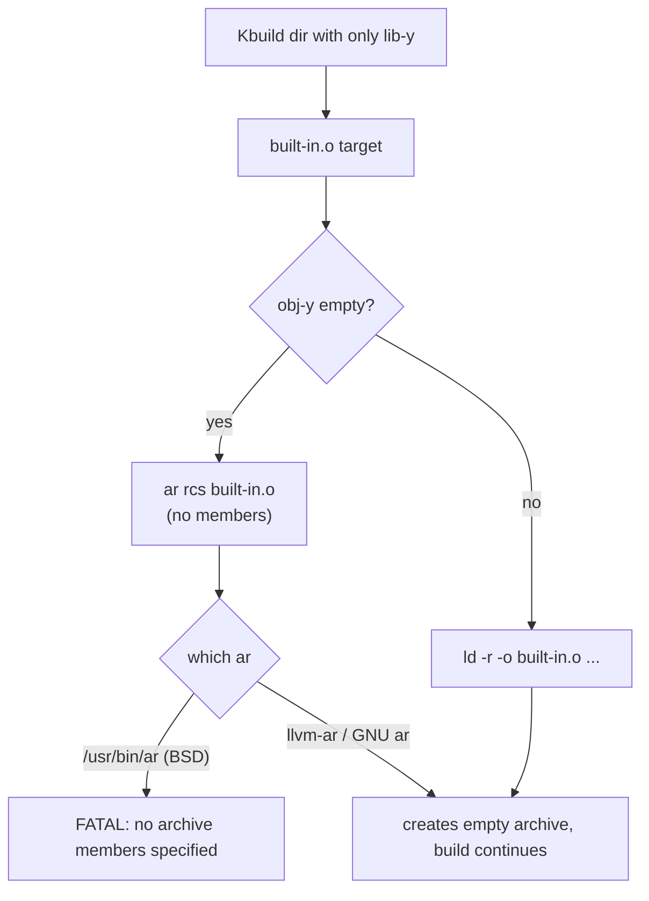

macOS `/usr/bin/ar` rejects empty archives with `ar: no archive members specified`, but kbuild (busybox, Linux kernel) routinely creates an empty `built-in.o` for any directory whose Kbuild only defines `lib-y`. The build dies at AR time with no compile error, which reads like a mysterious failure in an unrelated directory.

Point `AR` at `llvm-ar` (and `RANLIB` at `llvm-ranlib`). The same applies when cross-compiling ELF: Apple's `ar`/`nm`/`ld` cannot read ELF objects at all, so `llvm-ar`, `llvm-nm`, `llvm-strip` are needed even for the Linux targets.



## Symptom

```
  AR      libbb/lib.a
  rm -f archival/built-in.o; ar rcs archival/built-in.o
ar: no archive members specified
make[2]: *** [archival/built-in.o] Error 1
```

There is no compiler error, and the directory named in the failure is not the one that is broken. `make -j1 V=1` reveals the `ar rcs` invocation has zero members.

## Fix

```sh
AR=/opt/homebrew/opt/llvm/bin/llvm-ar
RANLIB=/opt/homebrew/opt/llvm/bin/llvm-ranlib
NM=/opt/homebrew/opt/llvm/bin/llvm-nm
STRIP=/opt/homebrew/opt/llvm/bin/llvm-strip
```

Pass these as `make` variables, not just `CC`: busybox derives `CC`/`AR`/`LD` from `CROSS_COMPILE`, so overriding only `CC` leaves Apple's tools in place.

## Related trap in the same build

`busybox`'s `CFLAGS_busybox += -static` (from `CONFIG_STATIC=y`) cannot work on Darwin — Apple ships no static libSystem, so `-static` fails at link time with `ld: library not found for -lcrt0.o`. A fully static Mach-O does not exist; `CONFIG_STATIC` must be `n` for macOS and the binary links libSystem.
