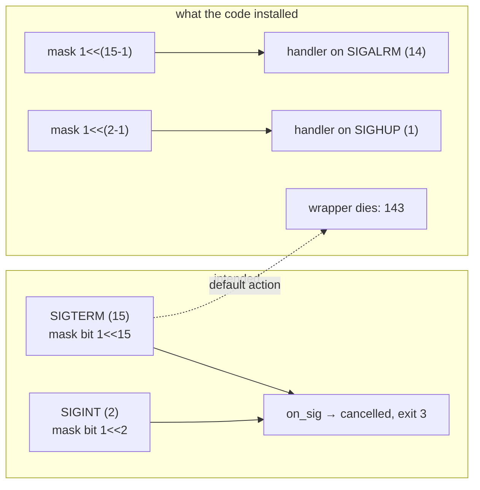

`run`'s cancellation path was dead code: `bb_signals()` takes a mask of `1 << signo` (the convention `BB_FATAL_SIGS` in `include/libbb.h` spells out), and `run` passed `1 << (SIGINT - 1)` and `1 << (SIGTERM - 1)`. That installs the handler one signal *below* the intended ones — SIGHUP and SIGALRM — so a `kill -TERM` of the wrapper killed it outright: exit 143, `cancelled=0` in `meta`, and the documented exit 3 never happened. The guest still disappeared, because the watchdog fired when the wrapper died, so every existing test passed: `tests/wrapper-signals.sh` asserts "the guest is gone", not the wrapper's exit code.

## Why the tests did not catch it

- The deadline path (`--timeout`) sets `m.timed_out` itself and returns 3; it never depends on the handler.
- The watchdog makes "guest gone" true even when the wrapper dies by signal.
- `SIGINT` looked fine by accident: bash starts background jobs with SIGINT ignored, so the wrapper simply ran to completion (exit 0 after the full 30 s sleep), which reads like "no crash".

## The rule

- Pass `(1 << SIGINT) | (1 << SIGTERM)`. Verify by sending SIGTERM to the wrapper *itself* — a `timeout N busybox run …` around it reports 143 from `timeout`, not the wrapper's status, so the probe must be `busybox run … &` and `kill -TERM $!`.
- Assert the wrapper's exit code (3) and `cancelled=1` in `meta`, not just that the guest died. `tests/pty.sh` S7.9/S7.10 do this in pty mode; the same two assertions are worth having for the pipe path.
