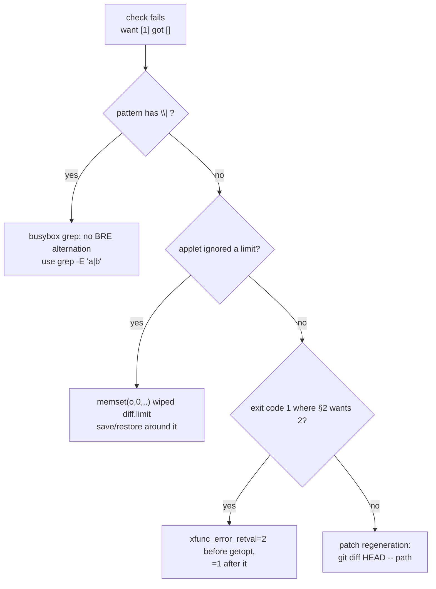

Writing 1000 cross-platform checks over the agent applets found four traps that each cost a debugging round, and one of them is a live defect in the patch series: `patches/0006` and `patches/0009` both carry the same `miscutils/why.c` hunk, so `patch -p1` reports "Ignoring previously applied" on 0009.

## busybox grep has no `\|` alternation in BRE

`grep -q 'a\|b'` silently never matches, so every check written that way fails with an empty result even though the text is present. Use `grep -E 'a|b'`. This bit 14 checks at once and looked like an applet bug.

## `memset(o, 0, sizeof(*o))` wipes caller-supplied limits

`editors/replace.c` set `o.diff.limit` from `--max-diff-bytes` in the caller, then `edit_file()` started with `memset(o, 0, sizeof(*o))` — the budget vanished and `diff_truncated` was always `false`. A comment even claimed "limit survives". Save and restore the field around the memset.

## Only usage errors may exit 2

§2 wants exit 2 for a usage error and 1 for an operational failure. `json`, `patchcheck`, `bench`, `snapshot`, `check` and `column` exited 1 for an unknown option, and `snapshot`/`check` exited 0 for `--format xml`. The fix is `xfunc_error_retval = 2;` before option parsing, then `xfunc_error_retval = 1;` right after it, plus a guard rejecting any format that is neither `json` nor `text`.

## Regenerating a patch for a file that patch adds

`git -C src diff -- path` prints nothing for a file that is only added by a patch; `git add -N` plus `git diff` prints the whole file. The form that works is `git -C src diff HEAD -- path` (staged plus unstaged). Two consequences: regenerating a whole patch from per-path diffs makes it cumulative with every *later* patch touching the same file (how 0006 absorbed 0009's change); and editing one section of a large patch by hand is safe when that section is a whole new file, because every line is a `+` line — splice the regenerated section in and bump the `@@ -0,0 +1,N @@` count.

Verify the series end to end, not just with `patchcheck` (structure only): `git -C src archive HEAD | tar -x -C /tmp/pristine`, then apply every patch with `patch -p1 -N --dry-run`. Today 0009 reports "Ignoring previously applied".
