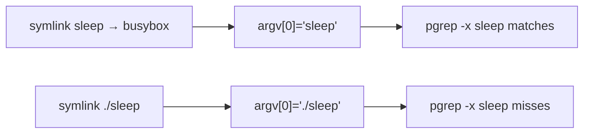

`pgrep -x` **does** work on Darwin. An earlier note here claimed it never matches; that was wrong, and the error came from the test harness, not the applet. Matching is on `argv[0]` — the name the process was *invoked* as — so `pgrep -x sleep` matches a symlink named `sleep` and does not match one named `./sleep` or `bbprobe-sleeper`.

## What the two platforms actually do

Same source, same answer, verified with a real symlink on both:

| command | darwin-arm64 | linux-arm64 |
|---|---|---|
| `pgrep sleep` | matches | matches |
| `pgrep -x sleep` | matches | matches |
| `pgrep -l sleep` | `8 sleep` | `8 sleep` |
| `pgrep -a sleep` | `8 sleep 20` | `8 sleep` |
| `pidof sleep` | matches | matches |

The one real difference is `-a`: Darwin prints the whole command line, Linux prints only `argv[0]` for a multicall applet. That is a display difference, not a matching one.

## Two traps that produced the wrong conclusion

- **A shell variable set inside a backgrounded `&&` chain is not set outside it.** `B=… && sleep 20 & sleep 1; $B pgrep …` runs the *system* `/usr/bin/pgrep`, whose `-a`/`-l` semantics differ and which complained `illegal option -- -` on `--help`. That last detail is the tell: busybox applets accept `--help`.
- **A symlink must be named after a real applet.** `ln -sf busybox bbprobe-sleeper` gives `bbprobe-sleeper: applet not found`, so nothing was running and every `pgrep` probe legitimately returned nothing.

Check the applet before believing the result: `busybox pgrep --help | head -1` must print `BusyBox v…`, not `illegal option`.
