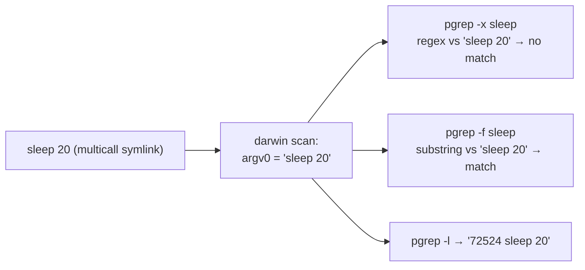

`pgrep`, `pkill`, `pidof`, `killall` and `ps` are all built into the Darwin binaries (276 applets) on top of KERN_PROC_ALL + KERN_PROCARGS2, and substring matching works. But on Darwin `pgrep -x` can never match, because the "name" it compares against is the *whole* joined command line, not `argv[0]`.



## Measured on the darwin build

```
$ pgrep sleep          -> 72626 72524      (substring, works)
$ pgrep -f sleep       -> 72626 72524      (full line, works)
$ pgrep -x sleep       -> (nothing)        broken
$ pgrep -l sleep       -> 72626 sleep 20   the whole argv, not comm
$ pgrep -a sleep       -> 72626 sleep 20   same as -l
$ pgrep -x-nomatch     -> exit 1           correct
$ pkill -x sleep       -> exit 1, kills nothing; pkill sleep works
```

## Why

Upstream `pgrep` computes the match text as `proc->argv0` and, without `-a`, truncates it at the first NUL to recover `argv[0]`. On Linux `/proc/PID/cmdline` still holds those NULs, so `-x sleep` compares `"sleep"`. The Darwin walker in `libbb/procps.c` hands back an already-joined line (`"sleep 20"`, no interior NUL), so the truncation is a no-op and `-x` compares against the whole command line. `-l` and `-a` then print the same string.

## What to use instead

Match on the full line and anchor it explicitly, and kill the same way:

```sh
busybox pgrep -f '^sleep '        # matches, on both platforms
busybox pkill -f '^sleep '
```

Do not reach for `-x` on Darwin: it exits 1 and `pkill -x` silently kills nothing, which is the dangerous half of the bug.
