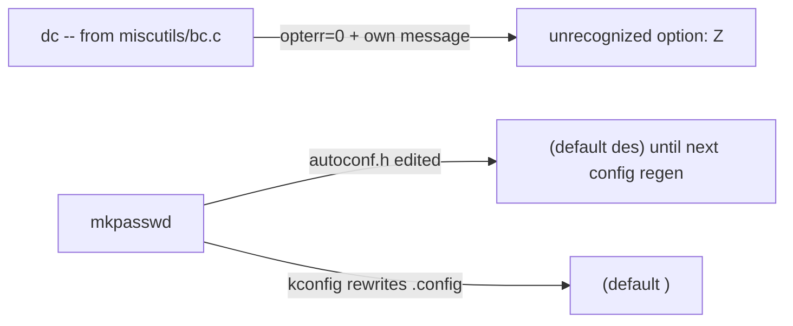

`dc` now prints the same diagnostic as Linux on Darwin — `dc: unrecognized option: Z` — and the patch series is re-cut and verified. `mkpasswd` is **not** durably fixed: the value only sticks while `autoconf.h` holds it, and kconfig rewrites `.config` back to empty.



## `dc` is built from `miscutils/bc.c`, not `miscutils/dc.c`

That is why three rounds of edits to `miscutils/dc.c` had no effect: `grep -rn 'int dc_main' src --include=*.c` finds it in **both** `miscutils/dc.c` and `miscutils/bc.c:7548`, and the build compiles the one in `bc.c` (`no dc.o` in the build tree; a `MARK-DC` marker in `dc.c` never reached the binary). The fix, in `bc.c`'s `dc_main`:

```c
opterr = 0;                                  /* libc's wording varies */
...
default:
	bb_error_msg("unrecognized option: %c", optopt ? optopt : '?');
	bb_show_usage();
```

Verified identical to the Linux binary for both `-Z` → `dc: unrecognized option: Z` and `--nosuchopt` → `dc: unrecognized option: -`. The dead `opterr` was removed from `miscutils/dc.c` so it stops misleading readers.

## `mkpasswd` — the honest state

Editing `build/…/include/autoconf.h` to `#define CONFIG_FEATURE_DEFAULT_PASSWD_ALGO "des"` and rebuilding gives `(default des)`; the next full config regeneration rewrites `.config` back to `CONFIG_FEATURE_DEFAULT_PASSWD_ALGO=""`, `autoconf.h` follows, and the text returns to `(default )`. `build.sh` now sets the symbol with `set_cfg` *after* its oldconfig step, but that path is **unverified**: the same rewrite may happen on the next `make`. Anyone picking this up should trace why kconfig re-derives this string symbol (its `depends on PASSWD || CRYPTPW || CHPASSWD` and the value in `build/darwin-arm64/.config`) before trusting any fix.

## `ifconfig`

`src/networking/interface.c:1253` now prints the Linux *shape* — `<ifname>: error fetching interface information: <errno text>` — but two differences remain and are inherent: `bb_perror_msg` prefixes the applet name, and Darwin's `strerror(ENODEV)` reads "Operation not supported by device" where glibc says "Device not found".

## State

`agent-ops 1299/0`, `sweep 1267/0/8sk`, `busybox patchcheck` → **checked=21 bad=0**, `tests/patch-reconstruct.sh` → **files differing: 0**. The series is 21 patches: the empty `0019-dc-error-diagnostics` was deleted and `0020`/`0021` renumbered, and `dc`/`bc.c`, `ifconfig`/`interface.c` moved into `0021-platform-parity-arch-pgrep-fdisk-usage.patch`.
