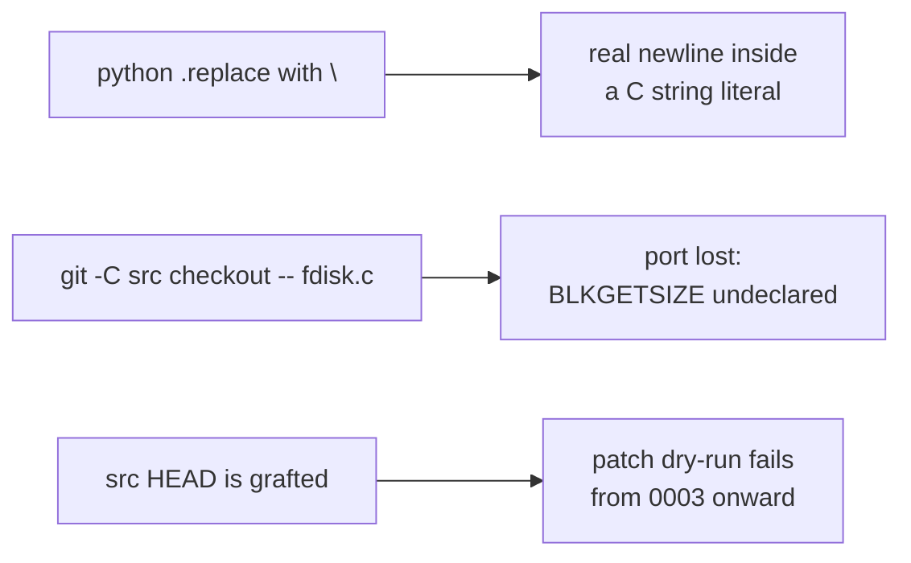

Four things went wrong in one pass and all four are load-bearing for anyone touching this tree: a Python `"\n"` corrupted a C string literal, `git checkout` on `src/` reverted a Darwin port, the pristine-apply check is comparing against the wrong base, and an edited `//usage:` line still does not reach the binary.



## A Python replacement wrote a real newline into C source

`'"Change partition table\n"'` in a Python string is a *newline character*, not the two characters `\` `n`. `fdisk.c` ended up with `//usage:\t"Change partition table<newline>"`, and a later edit mangled neighbouring strings into `"n table\n"`. The tell was grepping the **generated** file: `build/deep-darwin/include/usage.h` showed `"n table"` where `src/include/usage.h` showed the intact `IF_FEATURE_FDISK_WRITABLE(...)` form. Use `sed` with single quotes, or `r'...\n...'`, for anything containing `\n`.

## `git -C src checkout -- <file>` reverts the port, not just your edit

`src/` is an upstream clone whose *working tree* carries every patch. Restoring `util-linux/fdisk.c` that way threw away the Darwin port and the build failed with `use of undeclared identifier 'BLKGETSIZE'` at `fdisk.c:496`. To restore a ported file, apply the series to a clean export and copy the file back:

```sh
rm -rf /tmp/prf && mkdir /tmp/prf && git -C src archive HEAD | tar -x -C /tmp/prf
cd /tmp/prf && for p in /path/to/repo/patches/*.patch; do patch -p1 -s -N < "$p"; done
cp util-linux/fdisk.c /path/to/repo/src/util-linux/fdisk.c
```

## The pristine-apply check now fails from 0003 onward

`git -C src log --oneline -1` reports `aac079e (grafted, HEAD -> master, origin/master)`, and `patch -p1 --dry-run` on `0003-gnu-long-options.patch` says *"Ignoring previously applied (or reversed) patch"*. The clone's HEAD is not the base the series was cut against, so eighteen patches "fail" against a tree that already contains them. That is a **base mismatch to fix**, not a broken series — but until it is fixed, the end-to-end apply check proves nothing.

## An edited `//usage:` line still does not appear

After a clean, error-free rebuild, `busybox fdisk --help` prints the banner, a blank line and `Usage:` — no description at all — while `src/util-linux/fdisk.c:82` reads `"Change partition table\n"` and `Config.in`/`usage.h` look right. The generated `usage.h` did pick the text up at one point, so the remaining gap is in how `usage.o` is rebuilt. `agent-ops 1299/0` and `sweep 1267/0/8sk` pass regardless.
