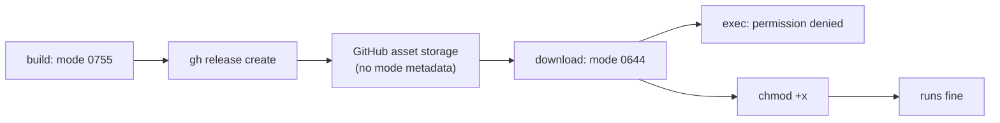

GitHub release assets **lose the executable bit**. `gh release download` (and any browser download) yields mode `0644`, so a published busybox fails with `permission denied` until the user runs `chmod +x`. This was found by downloading the first release back and trying to run it in a container.

## Consequences for the harness too

A verification step that downloads assets and executes them must `chmod +x` first, or it reports a false failure against a perfectly good artifact. The bytes are fine — only the mode is lost, and the SHA-256 is unaffected (it hashes content, not metadata).

## Second trap: bind-mounting a downloaded binary into a container

Docker Desktop on macOS presents bind-mounted files `noexec`, so `docker run -v $PWD/bb:/bin/busybox` fails with `permission denied` even after `chmod +x`. Copy the file into an image (`COPY busybox /bin/busybox`) instead; that also matches how the artifact will actually be used.

A `FROM scratch` image needs the applet symlink farm, otherwise bare `uname` fails with `not found`. Invoke applets through the binary (`/bin/busybox uname -m`) or copy the full `dist/<target>/` tree.

## What this means for users

The release notes must say `chmod +x` explicitly, and per-artifact `.sha256` sidecars should be published so one download can be verified without fetching the whole set.
