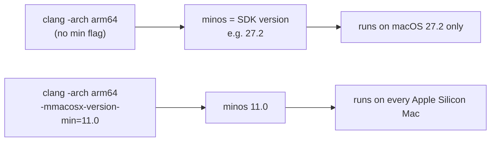

`clang -arch arm64` with no `-mmacosx-version-min` stamps the Mach-O `minos` load command with **the SDK's own version**, not a floor. On this machine (SDK 27.2) that produced binaries claiming `minos 27.2`, which refuse to launch on any older macOS — silently breaking "one binary for all Macs".

## Floors that work

| arch | flag | why |
|------|------|-----|
| arm64 | `-mmacosx-version-min=11.0` | Big Sur is the first release any Apple Silicon Mac ever ran; nothing older exists |
| x86_64 | `-mmacosx-version-min=10.13` | High Sierra; every Intel Mac still in service. 10.9 also links and passes the test suite if wider coverage is wanted |

`clang` accepts targets well below the SDK's `MinimumDeploymentTarget` metadata (12.0 here) and emits no warning, so the SDK is not the limiting factor.

Check the result rather than trusting the flag: `otool -l bin | grep -A1 VERSION_MIN` shows `minos N` for 11.0+ and the older `LC_VERSION_MIN_MACOSX version N` form below 11.0. Compile the `.o` files with the same flag — `otool -l some.o` must show the same floor, else `ld` warns "built for newer macOS version".

## Universal binaries

Two slices may carry *different* minimums; each keeps its own `LC_BUILD_VERSION`. `lipo -create` therefore does not require matching floors. `lipo` output loses the arm64 ad-hoc signature, so `codesign -s - --force` the result.

## x86_64 CPU baseline

clang's macOS x86_64 default is `-target-cpu penryn` (SSE4.1, 2008+) and emits no AVX unless asked, so do not add `-march=native`. Confirm with `otool -tv bin | grep -cE 'vmovdq|vpxor|vzeroupper'` — expect 0.
