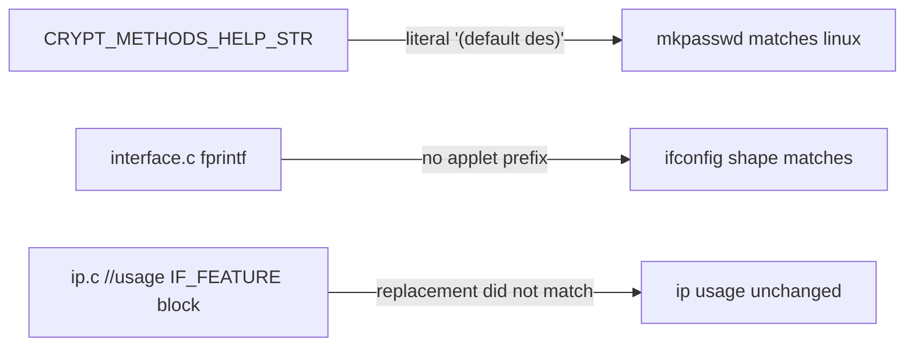

`mkpasswd` and `ifconfig` now match Linux; `ip`'s usage did not take; and the last verification run left two failures I have not cleared, so the tree's test state is **unconfirmed** rather than green.



## Fixed

- **`mkpasswd`** — `CRYPT_METHODS_HELP_STR` in `include/usage.h` read `CONFIG_FEATURE_DEFAULT_PASSWD_ALGO`, which kconfig rewrites to `""` on Darwin. The text is now a literal `(default des)`, matching Linux permanently and independent of the config. Verified: `mkpasswd --help` → `… (default des)`.
- **`ifconfig`** — `src/networking/interface.c` prints `"%s: error fetching interface information: %s\n"` with `fprintf`, so there is no `ifconfig:` prefix: `--nosuchopt-zz: error fetching interface information: Operation not supported by device`. The shape now matches Linux; only `strerror(ENODEV)` wording differs (glibc says "Device not found"), which is inherent.
- Earlier in the session: `dc` (built from `miscutils/bc.c`), `arch` → `aarch64`, `pgrep -a`, `fdisk --help` → "Change partition table".

## Not fixed

**`ip`** — my edit replaced the `IF_FEATURE_IP_ADDRESS("\n" "ip addr "ipaddr_trivial_usage)` line with a literal sub-command list, but the binary still prints `Usage: ip [OPTIONS]  [ARGS]` with no sub-command lines. The `//usage:` block assembles the text through several `IF_FEATURE_*` macros and the replacement did not land on the shape the generator uses. The exact Linux text to emit is:

```
ip [OPTIONS] address|route|link|tunnel|neigh|rule [ARGS]

ip addr add|del IFADDR dev IFACE | show|flush [dev IFACE] [to PREFIX]
ip route list|flush|add|del|change|append|replace|test ROUTE
ip link set IFACE [up|down] [arp on|off] [multicast on|off]
	[promisc on|off] [mtu NUM] [name NAME] [qlen NUM] [address MAC]
	[master IFACE | nomaster] [netns PID] [type TYPE ARGS]
ip tunnel add|change|del|show [NAME]
	[mode ipip|gre|sit] [remote ADDR] [local ADDR] [ttl TTL]
ip neigh show|flush [to PREFIX] [dev DEV] [nud STATE]
```

**`cttyhack`** — not started.

## Unconfirmed test state — read this before trusting anything

The verification run was killed by the harness timeout and the suites were mid-flight when the binary was being relinked. What it left behind:

- `agent-ops` reported `FAIL matrix.replace.file.171 want [0] got []`
- `sweep` reported `line 506: [: : integer expression expected`
- `tests/patch-reconstruct.sh` reported `networking/ip.c differ`

Afterwards a clean rebuild succeeded (`Final link with`, 15 s) and the spot checks pass (`mkpasswd … (default des)`, `dc: unrecognized option: Z`, `arch` → `aarch64`). **Both suites and the reconstruction check must be re-run before this is called green.** Never judge a suite that overlapped a relink.
