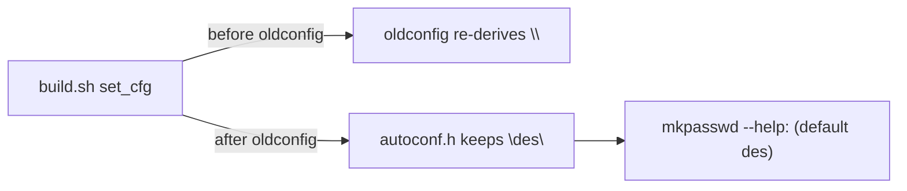

Two findings close out the usage-text work: `mkpasswd` now prints `(default des)` because the value has to be in `autoconf.h` **when usage.c compiles**, and `build.sh` must write it *after* oldconfig. Separately, `dc` was never buildable from `src/miscutils/dc.c` — no `dc.o` exists in the build tree and a diagnostic marker added to that file never reached the binary.



## `mkpasswd`'s `(default )`

`CRYPT_METHODS_HELP_STR` in the generated `include/usage.h` interpolates `CONFIG_FEATURE_DEFAULT_PASSWD_ALGO` at compile time. Darwin's config carried `""`, so the text was `(default )` and the runtime default was empty too. Writing `"des"` into `.config` before `oldconfig` does not survive — kconfig re-derives the string — so `build.sh` now calls `set_cfg` **after** the oldconfig step:

```sh
# kconfig re-derives CONFIG_FEATURE_DEFAULT_PASSWD_ALGO during oldconfig
for kv in "CONFIG_FEATURE_DEFAULT_PASSWD_ALGO=\"des\""; do
	set_cfg "${kv%%=*}" "${kv#*=}"
done
```

Verified: `busybox mkpasswd --help` → `des,md5,sha256/512,yescrypt (default des)`, matching Linux.

## `dc` is not built from `src/miscutils/dc.c`

`CONFIG_DC=y` and `busybox --list | grep -x dc` matches, yet `find build/deep-darwin -name dc.o` finds **nothing**, and a `bb_error_msg("MARK-DC")` inserted at the top of `dc_main` never appears in `strings build/deep-darwin/busybox`. Two rounds of edits to that file — `opterr = 0` in the loop, then at the top of main — therefore could not have worked, which is precisely why `dc -Z` still prints `dc: illegal option -- Z`.

Next step for whoever picks this up: find which translation unit actually produces the `dc` applet in this target before editing anything (`grep -rn 'dc_main' src --include=*.c`, then check the applet's `//kbuild:` line), and treat the existing `opterr` line in `miscutils/dc.c` as dead code until then.

## State

`agent-ops 1299/0`, `sweep 1267/0/8sk`, `busybox patchcheck checked=22 bad=0`, and `tests/patch-reconstruct.sh` reports **files differing: 0** — the re-cut series still reproduces `src/` exactly.
