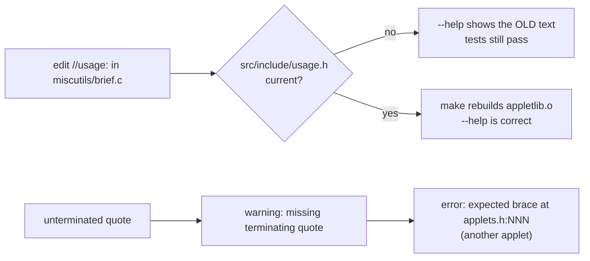

Adding a `.c` file with a `//applet:` line is not enough, and neither is editing an existing applet's `//usage:` block: `src/include/applets.h` and `src/include/usage.h` are checked-in *generated* files, gitignored, and if stale the applet is absent from `--list` (`brief: applet not found`) or its new usage text never reaches `--help` while every test still passes. Fix: `cd src && ./scripts/gen_build_files.sh . .` (SRCTREE OBJTREE), then rebuild — the patch carries only the `.c`.

Two copies of each generated header exist and the compiler prefers the source-tree one, which is what makes staleness so confusing:

* `src/include/{applets.h,usage.h}` — in the source tree, generated, gitignored, and **preferred** by `#include "applets.h"`;
* `build/<target>/include/{applets.h,usage.h}` — regenerated by `make`.

Deleting only the build-dir copies changes nothing. Deleting the source-tree ones makes the next build regenerate them, but only once `gen_build_files.sh` has seen a well-formed usage block.

## A malformed `//usage:` line reports as a syntax error in another applet

`brief`'s `//usage:` block lost its closing quote while being edited. The build failed with

```text
include/usage.h:3174:6: warning: missing terminating '"' character
include/applets.h:294:10: error: expected '}'
note: in expansion of macro 'APPLET_NOEXEC'
include/usage.h:3174:6: note: expanded from macro 'brief_full_usage'
```

The line number named a different applet's registration. `applets.h:294` is innocent: `MAKE_USAGE()` splices `brief_full_usage` into a `{...}` initialiser there, so an unterminated string in the usage text unbalances the brace. When a build error mentions `APPLET`/`MAKE_USAGE` and a neighbouring applet, read the *warning* line, not the error line.

Generated usage text is never byte-verified, so the check is behavioural: after a `//usage:` edit, `busybox brief --help | grep -c -- '-c LIST'` must be 1. `tests/brief.sh` reads flags from behaviour rather than help, so it stays green while help is stale.

## A cached `.config` keeps the applet off

`build/<target>/.config` can hold `# CONFIG_BRIEF is not set` from before the applet existed, which is why a container run reports 751 failures with `brief: applet not found` while the source is fine — and `--list | wc -l` printing 0 in that dir is the other symptom. New `CONFIG_*` belong in `EXTRA_CONFIG` in `build.sh`; to flip one in a scratch dir, `sed -i '' 's/^# CONFIG_BRIEF is not set/CONFIG_BRIEF=y/'` then `yes '' | make -C src O=DIR oldconfig`. Never answer `make oldconfig` interactively to "just accept" a symbol: it takes defaults for every other symbol, enables dozens of applets, and breaks unrelated files.


