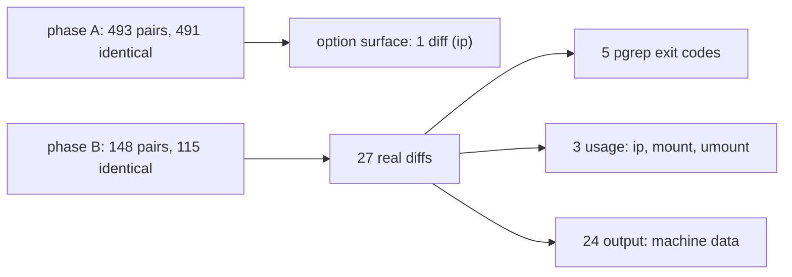

Fixing the audit's phase guard exposed what the truncated dumps had been hiding: with the behavioural probes actually running on both sides, **115 of 148 are identical and 27 differ** — `mount`/`umount` usage, five `pgrep` exit codes, and 24 output rows that are mostly the machine talking (`ps`, `free`, `df`, `uname`, `hostname`, `pwd`, `whoami`).



## Run one phase at a time

Phase B never executed in the container: the dump stopped right after phase A. The script now takes `PROBE_PHASE=A|B|all`, so each half is measurable on its own:

```sh
PROBE_PHASE=B ./tests/platform-probe.sh build/deep-darwin/busybox > /tmp/db.probe
docker run --rm -e PROBE_PHASE=B -v "$PWD:/w:ro" almalinux:9 \
	bash /w/tests/platform-probe.sh /w/build/deep-linux-arm64/busybox > /tmp/lb.probe
./tests/platform-diff.sh /tmp/db.probe /tmp/lb.probe
```

## What phase B found

| class | count | examples |
|---|---|---|
| exit | 5 | `pgrep sub/x/n/o` return 0 on darwin and 1 on linux for the same pattern; `pgrep -x` the reverse |
| usage | 3 | `ip` (known), `mount`, `umount` |
| output | 24 | `ps`, `free`, `df -h`, `du`, `uname -a/-s`, `hostname`, `id`, `whoami`, `pwd`, `realpath`, `printenv`, `env`, `killall -l`, `ls -l`, `mktemp -u`, `uptime`, `pgrep -fa/-P` |
| stderr | 1 | `cttyhack runs` — the container has no console |

Most of the 24 are the machine answering (process lists, memory, hostname, uid) — the same class as `arch`: identical command, different facts. The interesting ones are `pgrep`'s five exit-status differences and `mount`/`umount`'s usage text, because those are *behaviour*, not environment.

## The lesson

The option-surface audit was green at 491/493 while **18% of the behavioural probes disagreed**. A truncated dump looks exactly like a clean one — `platform-diff` happily reported "0 differences" over the pairs that happened to be present. Always check the two dumps are the same size before believing a comparison:

```sh
wc -l /tmp/d.probe /tmp/l.probe    # they must both cover the same phases
grep -c "# phase B" /tmp/l.probe   # must be 1, not 0
```
