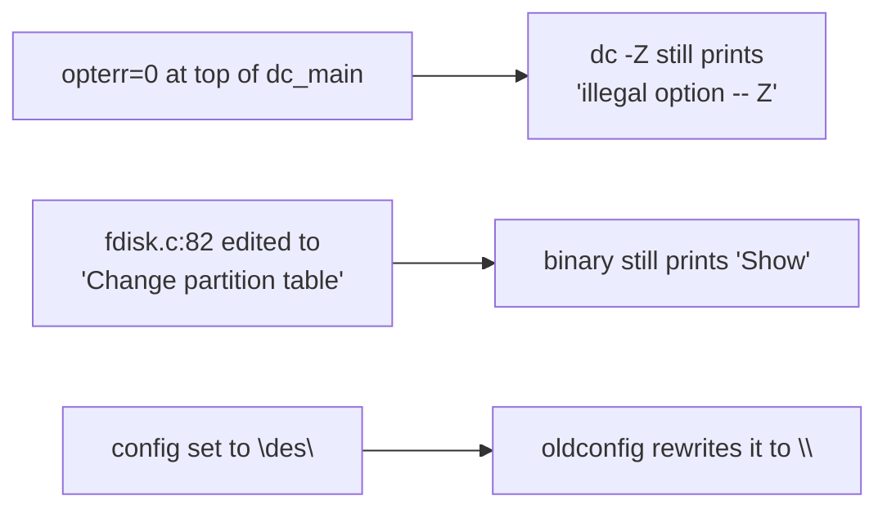

Three parity items dead-ended this pass, and each dead end is a fact worth having before the next attempt: `opterr = 0` does not silence `dc`'s diagnostic, an edited `//usage:` line did not change the rebuilt `fdisk` text, and `oldconfig` rewrites an empty default password algo back to empty even when it is set by hand.



## `dc`'s diagnostic is not opterr-gated

`src/miscutils/dc.c` sets `opterr = 0;` before `INIT_G()` and before the `getopt` loop, yet after a clean rebuild:

```
$ busybox dc -Z          # darwin
dc: illegal option -- Z
$ busybox dc --nosuchopt
dc: illegal option -- -
```

Linux prints `unrecognized option: -` for the same input. `grep -rn 'illegal option' src/ --glob '*.c'` matches only `src/shell/ash.c`, so the emitter is neither busybox's getopt32 path nor an opterr-controlled libc one. Next step: read the call path, do not add another `opterr`.

## A `//usage:` edit did not reach the binary

`src/util-linux/fdisk.c:82` was changed from `IF_FEATURE_FDISK_WRITABLE("Change")IF_NOT_FEATURE_FDISK_WRITABLE("Show")" partition table\n"` to `"Change partition table\n"`, rebuilt with no errors, and the darwin binary still prints `Show partition table`. So `include/usage.h` is not being regenerated from that line for this target — check the generation step before editing usage text again.

## `oldconfig` restores an empty string symbol

`CONFIG_FEATURE_DEFAULT_PASSWD_ALGO` sits at `""` in `build/deep-darwin/.config`. Writing `"des"` and running `yes '' | make -C src O=… oldconfig` puts `""` back, even though `src/loginutils/Config.in:182` already defaults it to `"des"`. Read the symbol's `depends on` chain (`PASSWD || CRYPTPW || CHPASSWD`) before trying again — the rewrite is dependency-driven.

## Undo an experiment cleanly

`src/` is an untracked upstream clone with its own history, so `git -C src checkout -- procps/nmeter.c` restores one file to pristine upstream. That is how the duplicated `getopt32` left by an earlier attempt was removed.

## Run the suites in the background

A foreground `agent-ops.sh` + `agent-ops-sweep.sh` pair ran past the harness deadline (899 s) and was killed. Launch them with `(nohup ./tests/agent-ops.sh build/deep-darwin/busybox > /tmp/a.out 2>&1 &)` and poll — both finish in ~100 s.
