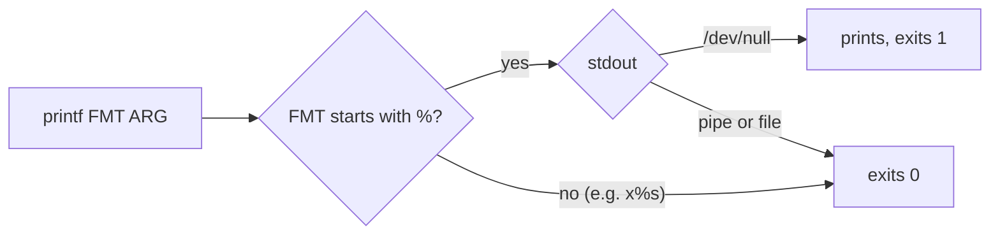

`busybox printf` exits **1** when the format string begins with a conversion and stdout is `/dev/null`, even though it succeeds. A `set -e` script that writes to `/dev/null` — a very common agent idiom — aborts on it.

Measured on `dist/darwin-arm64/bin/busybox`, and on two older local builds of the same tree, so it predates patches 0003/0004:

| invocation | stdout=/dev/null | stdout=file |
|---|---|---|
| `printf '%s' x` | **1** | 0 |
| `printf '%s ' x` | **1** | 0 |
| `printf '%d' 1` | **1** | 0 |
| `printf 'x%s' x` | 0 | 0 |
| `printf 'a%sb' x` | 0 | 0 |

## Why it matters

Agents emit `cmd >/dev/null 2>&1` constantly, and `printf` is how they generate text without a subshell. Under `set -e` the spurious 1 terminates the script, and the failure looks like the *next* command never ran rather than like printf failing.

## Workaround until fixed

Append a trailing newline (`printf '%s\n'`) — still exits 1 in the `%s\n` case measured earlier, so prefer `printf 'x%s'`-style formats beginning with a literal, or check the output rather than the status. `test.sh` itself asserts `printf %q` by comparing output for this reason: a guard like `if busybox printf '%q' 'a b' >/dev/null` silently skips the whole block.

## Where to look

`coreutils/printf.c` `printf_main()` returns `(argv2 < argv) || conv_err`; `print_formatted()`'s pointer-advance loop is the suspect, but the `/dev/null`-only trigger means the write path is involved too. Not investigated further here — it is upstream the whole way down.
