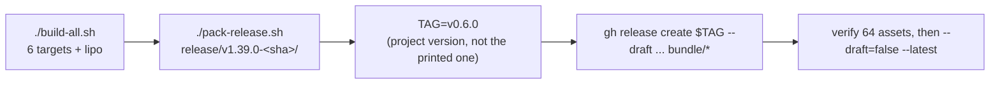

`pack-release.sh` prints a `next:` command using the **upstream** tag (`v1.39.0-aac079e`), which already exists as a release — following it would attempt a duplicate. Project releases are tagged with the project version instead (`v0.5.1`, `v0.6.0`), while the asset filenames keep the upstream name.



## What 0.6.0 did

```sh
./build-all.sh                                  # wipes build dirs, 6 targets + universal
./test.sh dist/darwin-arm64/bin/busybox         # 198 passed, 0 failed
docker run --rm -v "$PWD:/w:ro" almalinux:9 bash -c \
  'cp /w/test.sh /tmp/; chmod +x /tmp/test.sh; /tmp/test.sh /w/dist/linux-arm64/bin/busybox'   # 197 passed
./pack-release.sh                               # bundle + SHA256SUMS + NOTES.md
gh release create v0.6.0 --draft --title "busybox-static 0.6.0 (busybox 1.39.0.git)" \
	--notes-file /tmp/notes-0.6.0.md --target main release/v1.39.0-aac079e/*
gh release edit v0.6.0 --draft=false --latest
```

Verification that actually mattered before publishing: `otool -L` on both `-pure` slices shows exactly **one** dylib, `llvm-readelf -d` on both Linux binaries shows **0** `NEEDED` (static), `shasum -c SHA256SUMS` passes all 31 entries, and the suite numbers are recorded in the commit message.

## The two naming traps

- **The bundle directory is named after upstream, not the project version.** `release/v1.39.0-aac079e/` fed a `v0.6.0` release, so every asset reads `busybox-static-1.39.0-aac079e-*`. That is the house convention, but it reads as a mistake on the release page.
- **The release body should start with the project version line** (`busybox-static 0.6.0 (busybox 1.39.0.git)`) followed by the CHANGELOG section, then the licence and asset table from the generated `NOTES.md`. The generated file alone never mentions 0.6.0.
