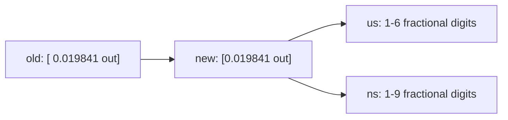

`run -t` stamps are trimmed, not zero-padded: `[   0.019841 out]` became `[0.019841 out]`, the seconds field is unpadded and fractional digits are trimmed (`0.019841`, `1.770`, `13.22`). Any check that asserts a fixed width now fails for a reason that has nothing to do with the applet.



## What to assert instead

```sh
# microseconds (default)          # nanoseconds (-n)
'^\[[0-9]+\.[0-9]{1,6} out\] '    '^\[[0-9]+\.[0-9]{1,9} out\] '
```

A `grep -c` on a fixed-width pattern (`{6}` or `{9}`) returns 0 and the suite reports a dozen failures across sections 24, 24b and 25 — the stamp code is fine, the pattern is stale.

## Shipped in 0.6.1

- `json -f FILE -g .a.b --set --value 42` and `--delete`, with `--json-value` for a typed value and `--dry-run` to print without writing. The document is re-serialised only after the edit applies to a parsed tree, so a parse or path failure leaves the file untouched.
- Compact timeline stamps as above.
- `tests/agent-ops-sweep.sh` updated to 1-6 and 1-9 digit patterns.

## Release steps that worked

```sh
./build-all.sh && ./test.sh dist/darwin-arm64/bin/busybox
./pack-release.sh
gh release create v0.6.1 --draft --title "busybox-static 0.6.1 (busybox 1.39.0.git)" \
	--notes-file /tmp/notes-0.6.1.md --target main release/v1.39.0-aac079e/*
gh release edit v0.6.1 --draft=false --latest      # after checking 64 assets
```

Verified before publishing: `test.sh` 198/0 on darwin-arm64 and 197/0 in almalinux:9, `agent-ops` 1299/0 darwin and 1318/0 linux, `agent-ops-sweep` 1311/0 and 1310/0, one dylib in each `-pure` slice, zero `NEEDED` in both Linux binaries, and all 31 `SHA256SUMS` entries OK.
