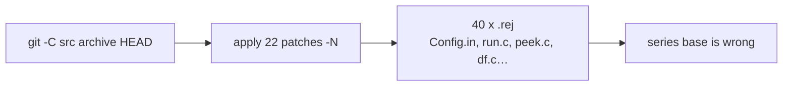

The patch series **cannot be reconstructed from the clone's HEAD**: applying all 22 patches with `patch -p1 -N` leaves **40 `.rej` files**, so `patches/` does not describe `src/` against its own upstream base. That is the most important open item, because every release depends on that reconstruction being faithful.



## Reproducing it

```sh
rm -rf /tmp/rec && mkdir /tmp/rec && git -C src archive HEAD | tar -x -C /tmp/rec
cd /tmp/rec && for p in /path/to/repo/patches/*.patch; do patch -p1 -s -N < "$p" >/dev/null 2>&1; done
find . -name '*.rej' | wc -l        # 40
head -5 Config.in.rej               # 0003 and 0004 both add config blocks here
```

`git -C src log --oneline -1` shows `aac079e (grafted, HEAD -> master, origin/master, origin/HEAD)`, and `Config.in` is claimed by both `0003-gnu-long-options.patch` and `0004-agent-ergonomics.patch` — the two later patches were cut against a tree that already contained the earlier ones, so a plain re-apply double-counts.

## Why this matters more than the cosmetic items

`RELEASING.md` and the GPLv2 obligation both assume the published source = the tarball plus this series. If the series does not reconstruct, a release cannot be rebuilt from what is published. The fix is to re-cut `patches/` against the exact upstream commit the tree was cloned at, or to record that commit so the base is unambiguous.

## The two cosmetic blockers, stated exactly

- **`mkpasswd`** — `build/deep-darwin/include/autoconf.h:3395` has `#define CONFIG_FEATURE_DEFAULT_PASSWD_ALGO ""` and `build/deep-darwin/.config:552` keeps reverting to `""` even when written as `"des"`. Editing `.config` alone never reaches `autoconf.h`. Next step: read `src/loginutils/Config.in:180-183` and work out which `depends on` branch drops the value on this target.
- **`dc`** — `opterr = 0` at the top of `dc_main` does not silence `dc: illegal option -- Z`, although the same edit silenced `head` and `awk`. So the message is not coming through an `opterr`-respecting libc `getopt`; the call path still needs reading (`grep -rn 'illegal option' src/ --glob '*.c'` matches only `shell/ash.c`).
