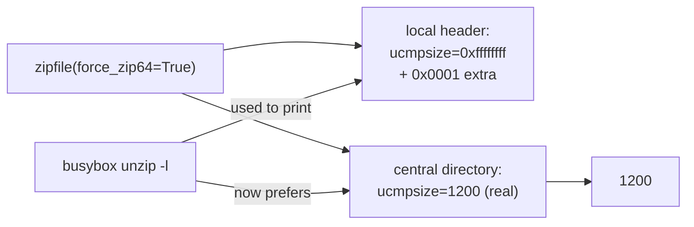

`unzip -l` printed `4294967295` for every entry of a Zip64 archive written by Python, even though extraction worked. The cause is a split brain between the two headers: Python's `force_zip64=True` puts `0xffffffff` **only in the local header** and keeps the true sizes in the **central directory**, while busybox listed the local header's value.

Measured on a 1200-byte member: local header `ucmpsize=4294967295`, `extra_len=20`; central directory `ucmpsize=1200`, `extra_len=0`.

## What the code does now

`archival/unzip.c` gained `zip64_fix_sizes()`, called when either size in the local header is `0xffffffff`:

1. fall back to the central-directory sizes when the CDF holds a real value, and
2. if the CDF itself is `0xffffffff`, locate its extra field (`next_cdf_offset - extra_len - comment_len`) and parse subfield `0x0001`, where the 64-bit uncompressed then compressed sizes appear, in that order, and only for the fields that were `0xffffffff`.

Values above 4 GiB still truncate in the listing because the applet's size fields are 32-bit; extraction is unaffected (it streams from the local header). Fixing the display for >4 GiB needs a 64-bit field, not more parsing.

## Also learned here

Adding an applet needs **no** `Config.src`/`Kbuild.src` edits: `//config:config X`, `//applet:IF_X(...)` and `//kbuild:lib-$(CONFIG_X) += x.o` comments are scanned into the generated files. But the new symbol only lands in an existing `.config` if the file is regenerated — `rm -rf build/<target>` first, otherwise `oldconfig` drops a symbol Kconfig has not heard of yet and the applet silently does not appear.
