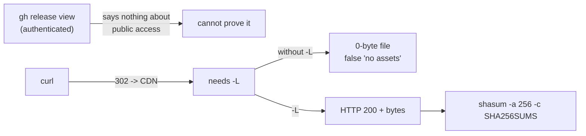

`gh` is authenticated, so it can never prove a release is publicly downloadable. Verifying that needs plain `curl` — and `curl` without `-L` silently fails on GitHub release assets, because `/releases/download/<tag>/<file>` 302s to a CDN.



## Recipe that actually proves it

```sh
# 1. visibility, unauthenticated
curl -s https://api.github.com/repos/OWNER/REPO | grep -E '"private"|"visibility"'

# 2. bulk download every asset (note -L)
U=https://github.com/OWNER/REPO/releases/download/TAG
curl -sL "$U/SHA256SUMS" -o SHA256SUMS
awk '{$1=""; sub(/^ +/,""); print}' SHA256SUMS | while read -r n; do
  curl -sL -w '%{http_code}' -o "$n" "$U/$n"
done

# 3. verify and run
shasum -a 256 -c SHA256SUMS      # expect N/N OK
chmod +x REPO-*-darwin-arm64 && ./REPO-*-darwin-arm64 | head -1
```

`chmod +x` is required: assets download as 0644.

## Publishing notes written for a different root

Docs authored in a workspace root (`busybox-static/RELEASING.md`) break once moved into the repo. Fix relative links (`../RELEASING.md`) and re-read every claim that asserts current state — three files still said the repo was private after it was flipped public. Correct the stale wording *before* changing visibility, not after.
