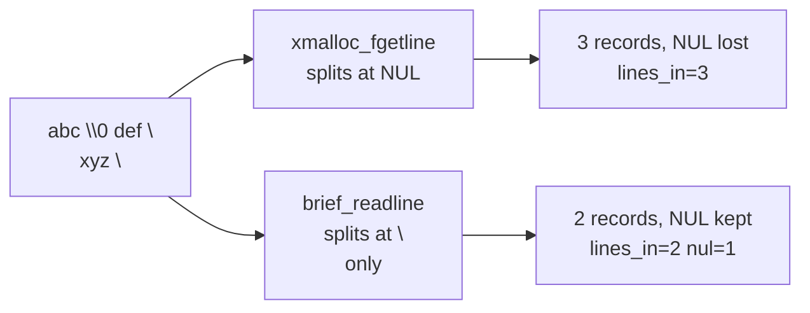

libbb's `xmalloc_fgetline()` stops at NUL, so any line-oriented applet that uses it silently splits a record in two and discards the NUL byte. `brief` hit this: `abc\0def\nxyz\n` came out as three records (`abc`, `def`, `xyz`) with the NUL gone, which breaks the promise that a shown record is the input byte for byte. The fix is a private reader that splits on `'\n'` only.

## The mechanism

`src/libbb/get_line_from_file.c` line 27: `if (ch == '\0') break;` — the chunk ends at the first NUL, and `xmalloc_fgetline()` then only strips a trailing `'\n'`. So the caller sees a normal string and has no way to know bytes were dropped. 41 files in this tree call it; `peek`, `run` and `log` do **not** (they are byte-oriented), but `grep` and `why` do.

## What to do

If records are data — anything an agent may hand back to a tool, or anything captured from a child process — read with `getc` until `'\n'`, keep a `(pointer, length)` pair, and use `memcmp`/`memchr`/`mem_contains` instead of `strcmp`/`strchr`/`strstr`. `brief` does this in `brief_readline()` plus its own `hash_bytes()` and `mem_contains()`; keys and samples are stored as bytes, never C strings. JSON output goes through `put_json_str(p, n)`, which escapes a NUL as `\u0000`.

## Two traps when testing this

A shell variable cannot hold a NUL, so `out=$(brief binary-file)` loses exactly the bytes under test — always write to a file and compare with `cmp`. And `0x0a` *is* a newline: a fixture built from "all 256 byte values" silently contains a record break, so build it as bytes 1-255 excluding 10. `tests/brief.sh` sections 15-20 cover both, 141 checks in total.
