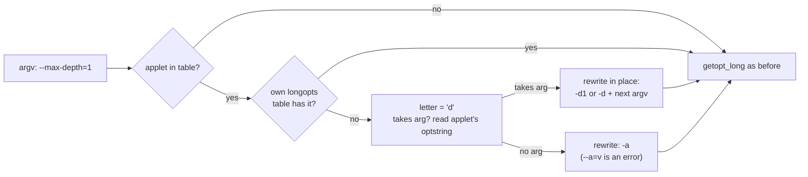

GNU long options for applets that only parse short ones are added by **one data table plus one argv rewrite**, not by touching each applet. `libbb/gnu_longopts.c` maps `(applet, "--long-name")` to the short letter it stands for, and `bb_expand_gnu_longopts()` is called at the top of `getopt32()`/`getopt32long()`, rewriting argv before `getopt_long` runs. 415 rows cover 77 applets.

Argument-ness is never stored in the table — it is read from the applet's own optstring at run time, so a row cannot drift. Rewrites are always shorter than the original (`--max-depth=1` → `-d1`), so they happen in the same buffer with no allocation. `--` ends the scan, and a name the applet declares itself wins, so `grep --color` and `ls --full-time` are unaffected.

## Three traps when extending it

1. **`/* */` comments in `libbb/Kbuild.src` break the build.** Kbuild.src is copied line-for-line into a makefile, so only `#` is a comment; anything else gives `Kbuild:91: *** missing separator`.
2. **Applets using plain `getopt()` never reach the hook.** `head` needs the legacy `-N` form, so it calls `bb_expand_gnu_longopts()` itself, before its own parser mangles argv. `awk` uses plain `getopt` deliberately (must preserve `-e`/`-f` order) and is left unmapped.
3. **Only map a name where the letter means what GNU means.** `ls -C` colorizes here but selects columns in GNU; `flock` has no `-c` at all despite its usage line suggesting one.

## Verify a row, don't eyeball it

Run `--long` and its `-x` and require identical exit status, stdout and stderr. That is stronger than "the option was not rejected" — it proves the rewrite produced the intended short option, and it caught both bad rows above.
