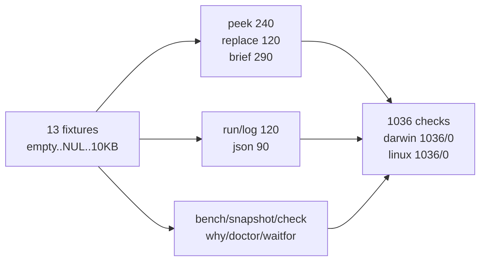

`tests/agent-ops-deep.sh` is the cross-platform behaviour suite: **1036 checks**, green on darwin-arm64 and in an AlmaLinux 9 container, in ~18 s per platform. It walks the input space instead of sampling it: the same operations over a fixed matrix of 13 file shapes (empty, 1 byte, no trailing newline, CRLF, bare CR, NUL, unicode, spaces, blanks, 10 KB line) so a platform difference shows up as a matrix row that flips.



## How to run it

```sh
# darwin (build into an isolated dir so dist/ is left alone)
./tests/agent-ops-deep.sh build/deep-darwin/busybox

# linux, native aarch64
docker run --rm -v "$PWD:/w:ro" almalinux:9 \
	bash /w/tests/agent-ops-deep.sh /w/build/deep-linux-arm64/busybox
```

Build those binaries without touching `dist/` (another session may be installing there):

```sh
mkdir -p build/deep-darwin && cp build/darwin-arm64/.config build/deep-darwin/.config
make -C src O=$PWD/build/deep-darwin -j18 CC="cc -arch arm64 -mmacosx-version-min=11.0" \
	AR=/opt/homebrew/opt/llvm@22/bin/llvm-ar NM=.../llvm-nm STRIP=.../llvm-strip \
	OBJCOPY="zig objcopy" RANLIB=.../llvm-ranlib
```

`/tmp/build-deep.sh` in this session did exactly that for darwin-arm64, linux-arm64 and linux-amd64, enabling the applet `CONFIG_*` symbols in a copy of the existing `.config`.

## What it checks, and the shape of a check

Checks are properties, not captured transcripts: an exit code from the §2 table, a field that must be present, a file that must be unchanged, bytes that must round-trip. Each applet gets a contract sweep (`--help` exits 0, unknown option exits 2, bad `--format` exits 2) before its behaviour is walked. Section 23 asserts that no applet exits 124 or 128+N for a plain failure and that `--help` is byte-identical across runs; section 24 asserts every JSON emitter carries `"schema":1`.

The single skip is `replace hit [blanks]`: the `blanks` fixture has no unique needle, so the hit-path check has nothing to replace.
