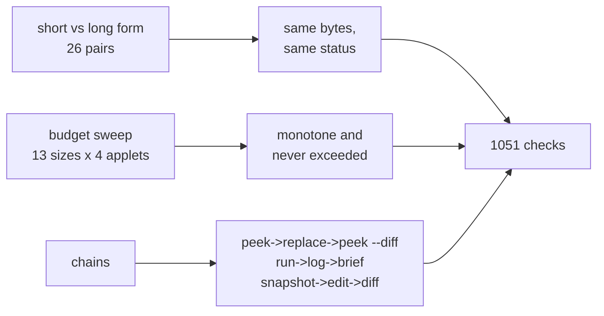

`tests/agent-ops-sweep.sh` covers the option space and the seams between applets: **1051 checks**, identical results on darwin-arm64 and AlmaLinux 9 (1043 passed, 8 skipped on both). Where `agent-ops-deep.sh` walks inputs, this walks *option equivalence and composition*.



## The four properties it asserts

- **Short equals long.** Every documented short option is run against its long spelling and both output and status must match byte for byte (26 pairs). Options whose output carries a run id, duration or path are compared on a stable field instead — `eqfield "run -B/--max-bytes" stdout_bytes ...`.
- **Budgets are monotone.** For `peek`, `brief`, `run` and `log`, 13 budgets from 0 to 4096 must each stay within the budget and never shrink the shown byte count as the budget grows.
- **Applets compose.** `peek` output is fed to `brief`; `run` output to `log` and then `brief`; `peek --diff` is checked before and after a `replace`; `snapshot` is diffed after an edit. A chain that changes the bytes it should pass through fails.
- **Failures are inert.** 13 applets × 4 fault kinds must exit inside the §2 table, never as a signal, and a malformed number or regex must leave the target file's md5 unchanged.

## Running it

```sh
./tests/agent-ops-sweep.sh build/deep-darwin/busybox
docker run --rm -v "$PWD:/w:ro" almalinux:9 \
	bash /w/tests/agent-ops-sweep.sh /w/build/deep-linux-arm64/busybox
```

## The skip is honest, not a hole

Eight checks skip, all for one reason: the `spaces` and `ten` fixtures start with a byte that appears many times (`' '`, `'l'`), so `replace` cannot use it as a unique needle and the "did the edit change the hash" chain has nothing to assert. The suite prints the reason rather than quietly passing.

## Stale binaries look exactly like platform bugs

`brief.sh` reported 767/9 on darwin and 776/0 in the container — not a platform difference: `src/miscutils/brief.c` had gained a `--count-by` option after the darwin binary was built. Rebuild both binaries from the same `src` before comparing platforms; a suite that fails on one platform only is usually a stale build, not a regression.
