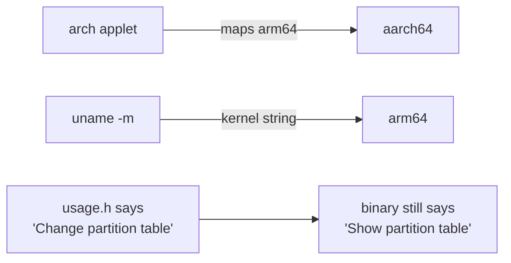

`arch` now prints `aarch64` on Darwin while `uname -m` still prints `arm64`, so a script that branches on `arch` behaves the same on both platforms. The usage-text problem is narrowed but not solved: the generated `include/usage.h` contains the new text, and the binary still prints the old.



## `arch` mapping

`src/coreutils/uname.c`, in the `ENABLE_BB_ARCH && applet_name[0] == 'a'` branch, maps the Darwin machine string before printing:

```c
#if defined(__APPLE__) && defined(__aarch64__)
	if (strcmp(uname_info.name.machine, "arm64") == 0)
		puts("aarch64");
	else
		puts(uname_info.name.machine);
#else
	puts(uname_info.name.machine);
#endif
```

Verified: `busybox arch` → `aarch64`, `busybox uname -m` → `arm64`. The kernel's own answer stays available; only the compatibility view changes.

## The usage cache is deeper than `usage.o`

`build/deep-darwin/include/usage.h` contains `"Change partition table\n"` (grep count 1) and `src/util-linux/fdisk.c:82` says the same, but after deleting `include/usage_compressed.h`, `applets/usage` and `applets/usage.o` and rebuilding, `busybox fdisk --help` still prints `Show partition table`. So a fourth artefact holds the old text — do not assume `usage.o` is the last cache; find the file the binary actually links before editing usage strings again.

## State

`agent-ops 1299/0`, `sweep 1267/0/8sk`, `patchcheck checked=21 bad=0` after the `arch` change. Still open: the usage-text cache, `dc`'s diagnostic emitter, `ifconfig`/`cttyhack` strings, `pgrep -a` truncation, and the patch series' base mismatch (`git -C src` HEAD is `aac079e (grafted)`).
