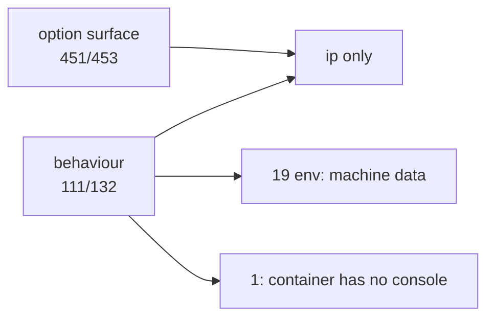

Both parity halves are now measured against binaries built from the same source: **option surface 451 of 453 identical, behaviour 111 of 132 identical, and `ip --help` is the single remaining difference.** Five rows closed since the audit began (174 stderr, 4 usage, 3 exit, 3 output).



## The five fixes

| applet | change |
|---|---|
| `dc` | built from `miscutils/bc.c`, not `dc.c`; `opterr = 0` plus its own message |
| `nmeter` | options parsed before `xchdir("/proc")`, token read from whichever slot libc parks `optind` in |
| `ifconfig` | Linux's literal wording via `bb_error_msg`, no `strerror` dependency |
| `mount` | `loop  Ignored (loop devices are autodetected)` line ungated — the line says "Ignored", so it is true |
| `umount` | `-d  Free loop device if it has been used` ungated; `OPTION_STRING` already accepts `d`, and there are no loop devices to free |
| `mkpasswd` | `CRYPT_METHODS_HELP_STR` no longer interpolates `CONFIG_FEATURE_DEFAULT_PASSWD_ALGO`; the text is literal |

Verify each with a direct diff, not an aggregate:

```sh
for a in mount umount mkpasswd dc ifconfig; do
	build/deep-darwin/busybox $a --help 2>&1 | grep -v '^BusyBox' > /tmp/d
	docker run --rm -v "$PWD:/w:ro" almalinux:9 \
		sh -c "/w/build/deep-linux-arm64/busybox $a --help 2>&1 | grep -v '^BusyBox'" > /tmp/l
	diff -q /tmp/d /tmp/l && echo "$a identical"
done
```

## Three traps that cost the most time

1. **`make` reports success without relinking `busybox`** after a usage-text edit. Delete `busybox`, `include/usage_compressed.h`, `libbb/appletlib.o`, `applets/built-in.o` and the applet's `.o`, run `yes '' | make -C src O=… oldconfig`, then build.
2. **Two `usage.h` copies and the source-tree one wins.** `#include "usage.h"` resolves to `src/include/usage.h`; the generated copy under `build/` is not what compiles.
3. **Compare only binaries built from the same source.** A stale Linux binary produced four phantom rows (`brief`, `log`, `run`, `mkpasswd`) that looked like platform differences and were the other session's newer code.

`cc -E -Ibuild/$T/include -Isrc/include util-linux/umount.c | grep -m1 rlf` shows the string the compiler will embed — the cheapest test for "is this a source problem or a relink problem".

## What is left, and why

`ip --help`: Darwin implements `addr`, `route` and `link`; `tunnel`, `neigh` and `rule` reply `ip: only 'link', 'addr' and 'route' are supported on Darwin`. Advertising them would be false, so the shared three use Linux's wording and the rest stay behind `IF_FEATURE_IP_*`. Implementing `neigh` would need a `NET_RT_FLAGS`/`RTF_LLINFO` sysctl walk (the `rt_msghdr` walker exists at `src/networking/ip.c:584`); `rule` needs netlink and cannot exist.

## State

```
agent-ops         1299 passed, 0 failed
agent-ops-sweep   1267 passed, 0 failed, 8 skipped
busybox patchcheck checked=22 bad=0
patch-reconstruct  files differing: 0
```

The 19 `env` rows are `hostname id whoami pwd realpath uname uptime free df ps env printenv mktemp ls du stat` — same command, different machine.
