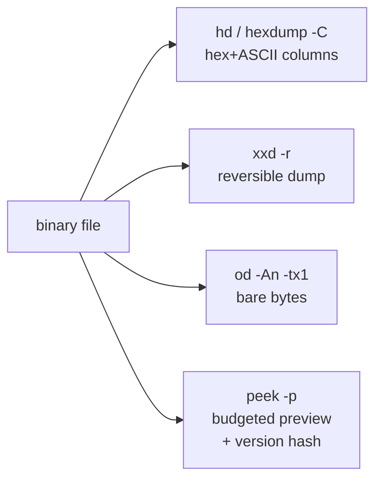

Five upstream binary viewers are enabled in every target, plus one applet this tree added. Reach for `hd` when a human will read it, `xxd` when the bytes must round-trip, and `peek -p` when an agent needs a bounded preview it can paste.



## What is compiled in

| applet | notes | config |
|---|---|---|
| `hexdump` | `-b -c -d -o -x -C`, `-e FMT`, `-n LEN`, `-s OFS` | `CONFIG_HEXDUMP=y` |
| `hd` | alias for `hexdump -C` | `CONFIG_HD=y` |
| `xxd` | `-g`, `-c`, `-ps`, `-i`, and `-r` to reverse: `xxd f \| xxd -r` is byte-exact | `CONFIG_XXD=y` |
| `od` | POSIX dump; `-An -tx1` for bytes only | `CONFIG_OD=y` |
| `strings` | `-n` minimum run, **default 4**, so `AB\0CD` prints nothing | `CONFIG_STRINGS=y` |
| `hexedit` | interactive hex *editor*, needs a tty | `CONFIG_HEXEDIT=y` |

Verify in a build with `busybox --list | grep -xE 'hd|hexdump|xxd|od|strings|hexedit'`.

## `peek -p`: the agent-facing one

`peek` sets `binary=true` by default on binary input and, with `-p`, prints a bounded hex preview:

```
$ busybox peek -p -l 1:1 f
f lines=1-1 version=sha256:fb46ae… binary=true
preview_bytes=6
000000  41 42 00 43 44 ff        AB.CD.
shown_bytes=0 truncated=false
```

Three things distinguish it from `hexdump`: `preview_bytes=` bounds what you are shown, `version=sha256:` can be re-checked later with `peek --diff HASH`, and `shown_bytes=0` because a preview is not line content. `hexedit` is the only applet that writes hex; `vi`, `ed`, `less` and `more` are present but do not edit bytes.
