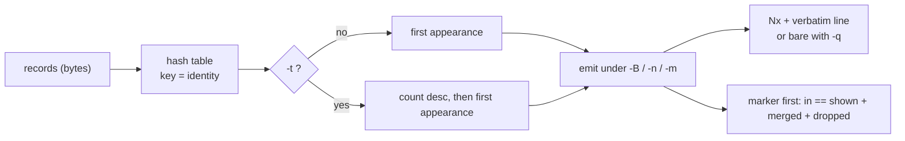

`brief` (patch 0014, `src/miscutils/brief.c`) reduces the number of records in line-oriented output and never edits a record: it groups, counts, projects, and reports every reduction on one greppable marker line. Since 2026-11-22 it also **aggregates** (`-c`, `-t`, `-m`), which is the view that answers "what repeats here" from one process instead of a `cut | sort | uniq -c | sort -rn` pipeline.

Build with `CONFIG_BRIEF=y`; test with `./tests/brief.sh <busybox>`: **776 checks**, ~65 s, green on darwin-arm64 (276 applets) and in an AlmaLinux 9 container against the aarch64-musl static build.

## The three laws

1. Reduce the number of records, never edit a record. A shown line keeps its bytes; `Nx ` is the only prefix ever added, and `-q` removes even that.
2. Count every drop: `lines_in == lines_shown + lines_merged + dropped_lines`, on every option set.
3. Say what was reformatted: `projected=` in the marker and `"projected"` in JSON.

## Flags

| flag | effect |
|---|---|
| `-d` | group identical records, first-appearance order |
| `-s` | group records equal after masking digit runs (implies `-d`) |
| `-c LIST` | group by these fields and show them: the aggregation |
| `-t N` | order groups by count, highest first (implies `-d`) |
| `-m N` | show only groups seen at least N times (implies `-d`) |
| `-q` | bare records: no `Nx `, no `+ ` |
| `-k STR` | never merge a record containing STR |
| `-f LIST` / `-S SEP` | project fields for display only; grouping still sees the original bytes |
| `-B` / `-n` / `-a` / `-F json` | byte budget, record cap, samples per group, machine-readable form |

`-c` is why `-t` and `-m` exist: `brief -c 2 -t 10` is the ten commonest values of field 2; `-c 1 -m 3` drops the singletons that make a first page useless; `-c 2 -f 3` groups on one field and prints another.

## Why `-t` matters more than it looks

With first-appearance order and a byte budget, a record repeated 3,000 times at the end of the input is invisible: the budget is spent on the 17 distinct records that arrived first. Measured on a 3,500-line fixture (500 unique, then one warning ×3,000), `brief -B 400` shows 17 singletons and `truncated=1`; `brief -t 3 -B 400` shows the `3000x` record first. Same bytes, opposite usefulness. On a real corpus the same shape appears as one gate error repeated 110 times.

## Cost

`brief.o` 8,264 → 10,288 B (+2,024 B); `__text` +1,012 B; `__cstring` +140 B on darwin-arm64, i.e. +0.13% of an 890 KB binary, inside the 5% budget of `AGENT-FEATURES.md` §7.

