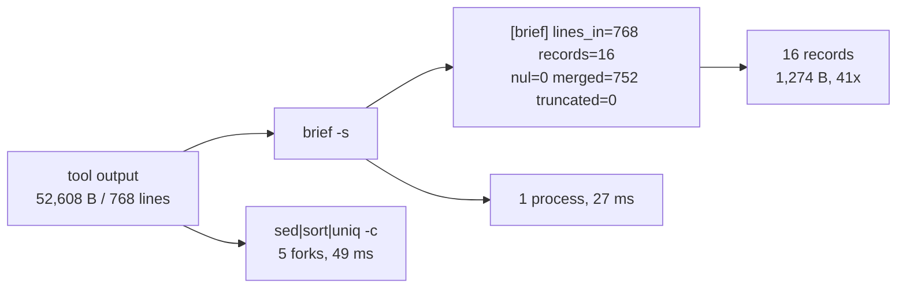

`brief` (patch 0014, `src/miscutils/brief.c`) is the generic readable-compression filter: it reduces the number of records, never edits a record, and reports every reduction on one greppable marker line. Records are **bytes**, not C strings — an embedded NUL is data. Build it with `CONFIG_BRIEF=y`, test it with `./tests/brief.sh dist/<target>/bin/busybox` (197 checks).

## What it does and refuses to do

Records are grouped by identity (`-d`) or by digits-masked identity (`-s`), first-appearance order preserved, printed as `Nx <verbatim line>`. It refuses the four things that break byte fidelity: no whitespace squeezing (column padding is the delimiter), no word abbreviation (output must stay quotable back into `grep`/`peek --around`), no line-tail truncation, and no merging on a projected line — `-f` affects display only, so grouping always sees the original bytes. `-k STR` marks caller-declared salience: matching lines print verbatim and are never merged.

## Byte-exactness

`brief_readline()` reads with `getc` until `'\n'`, so NUL, `'\r'`, `0x7f` and `0x80-0xff` all survive, and a CRLF record still differs from an LF one. Keys are compared with `memcmp` over length, so two records differing only *after* a NUL stay distinct; `-s` masks only `0x30-0x39`. The marker reports `nul=<n>`, the count of records that held a NUL. Do not use libbb's `xmalloc_fgetline()` here — it breaks at NUL (see `docs/gotchas/xmalloc-fgetline-splits-records-at-nul-and-loses-the-byte.md`).

## The invariant worth testing

`lines_in == lines_shown + lines_merged + dropped_lines` for every option combination; `tests/brief.sh` asserts it across 9 + 14 option sets. A record counts as merged only for the occurrences it did not display, so `-a N` cannot double-count. Measured: 716 source paths (18,940 B) → 7,995 B with `truncated=1`, and 768 build-error lines (52,608 B) → 16 records / 1,274 B, 27 ms versus 49 ms for the equivalent `sed|sort|uniq -c` pipeline. Cost is 4,352 B of `__TEXT` — inside the 5 % budget of `AGENT-FEATURES.md` §7.

## Gotchas found while building it

`fopen_or_warn_stdin(NULL)` is not NULL-safe in this tree — it tests `filename[0] == '-'` before `filename != NULL`, so a NULL argv segfaults; branch on `!*argv || !strcmp(*argv,"-")` and call `fopen_or_warn()` yourself. A `//usage:` line cannot contain `xstr(MACRO)`; use the literal. And `.config` newer than `include/autoconf.h` makes `make` run a prompting `silentoldconfig` that fails without a tty — run `yes '' | make -C src O=DIR oldconfig` first. When testing binary input, never capture output in a shell variable (a NUL cannot survive `$()`); write to a file and compare with `cmp`.
