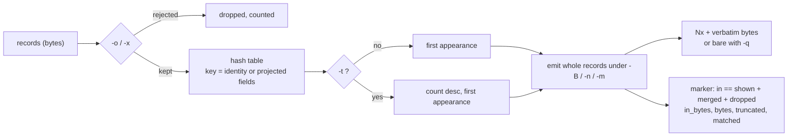

`brief` (patch 0014, `src/miscutils/brief.c`) reduces the number of records in line-oriented output and never edits a record. It now covers what people reach for a format-specific compressor (rtk) to do, using six orthogonal primitives and caller-supplied structure instead of a per-format registry: 879 checks green on darwin-arm64 and in AlmaLinux 9, and on every measured case it is smaller or more honest than `rtk` on the same input.

## The record model

A **record** is one line, or — with `-R STR` — every line up to the next line containing STR. That one flag is what makes multi-line output reducible without knowing the format: a commit, a pytest failure block, a stack trace or a `docker build` step becomes one record, so counting, ordering, thresholds, samples and the budget all work on it, and **a record is shown whole or not at all**. Lines before the first match form a prologue record, which is kept (and dropped as a unit if it cannot fit any budget, rather than emptying the view).

## Flags

| flag | effect |
|---|---|
| `-o STR` / `-x STR` | selection: show only / drop records containing STR (repeatable, OR) |
| `-R STR` | a record starts at each line containing STR |
| `-c LIST` | group by these fields and show them (the aggregation) |
| `-t N` / `-m N` | order by count; show only groups seen ≥N times |
| `-f LIST` / `-i SEP` / `-S SEP` | project fields; field separators in (`-i`) and out (`-S`) |
| `-d` / `-s` | group identical / digit-masked records |
| `-q` / `-k STR` | bare records; never merge a record containing STR |
| `-B` / `-n` / `-a` / `-F json` | byte budget, record cap, samples per group, machine-readable |

## Measured against rtk on the same input

| case | input | rtk | brief |
|---|---|---|---|
| `git log -30` | 18,918 B | `rtk git log` 9,672 B, lossy digest | `-R 'commit ' -B 2000` **2,020 B**, whole commits, byte-exact |
| pytest log | 17,137 B | `rtk log` 644 B (counts only), `rtk err` 772 B | `-o FAILED` **618 B** (the six failures); `-R '____' -B 900` 1,005 B (four whole blocks with code) |
| `grep -rn error src/libbb` | 36,000 B | `rtk rg` 14,361 B | `-i : -c 1 -t 20` **2,504 B** (top files by match count) |
| `ls -l src/libbb` | 11,129 B | `rtk ls` 779 B, 52 of 174 entries silently | `-q -f 9 -B 800` 999 B, 54 entries **and `truncated=1`**; unbounded it prints all 174 |
| wall time | — | `rtk ls` median 70.5 ms | `ls -l \| brief` median 35.7 ms |

The two smaller rtk numbers are the two lossy ones: `rtk log` prints a count and no messages, `rtk ls` drops 70% of the entries without saying so. `brief` never does either — `truncated=1` and `dropped_lines=` are in the marker of every incomplete view.

## The idioms that replace rtk subcommands

| what you used rtk for | brief |
|---|---|
| `rtk git log` | `git log \| brief -R 'commit ' -B 3000` |
| `rtk err CMD` | `CMD 2>&1 \| brief -o error -o warning -o fatal` |
| `rtk test` failures | `pytest 2>&1 \| brief -o FAILED` or `-R '____' -B 3000` |
| `rtk rg PATTERN` | `grep -rn PAT \| brief -i : -c 1 -t 20` |
| `rtk ls` | `ls -l \| brief -q -f 9 -B 2000` (add `-d -s` for counts) |
| `rtk log` | `brief -o error -s -t 10` (and it keeps the messages) |
| `rtk gain` | `brief -F json` / the marker's `in_bytes=` and `bytes=` — per call, no ledger file |
| `rtk json` | `busybox json` (patch 0010) `\| brief -d` |

## Cost and tests

`brief.o` 8,264 → 13,464 B, `__text` +2,064 B, `__cstring` +251 B: +0.26% of an 890 KB binary, inside the 5% budget of `AGENT-FEATURES.md` §7. `./tests/brief.sh <busybox>`: 879 checks (39 sections), of which 63 are invariant assertions across 30 option sets on three binary corpora.

