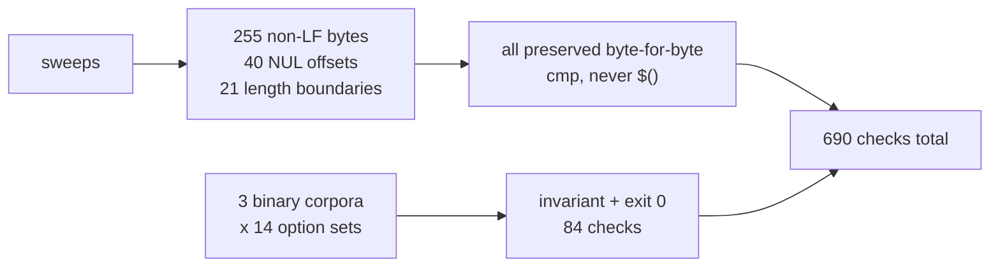

`brief` (patch 0014, `src/miscutils/brief.c`) is the generic readable-compression filter: it reduces the number of records, never edits a record, and reports every reduction on one greppable marker line. Records are **bytes**, not C strings — an embedded NUL is data. Build with `CONFIG_BRIEF=y`, test with `./tests/brief.sh dist/<target>/bin/busybox`: **690 checks, ~61 s**, green.

## What it does and refuses to do

Records are grouped by identity (`-d`) or by digits-masked identity (`-s`), first-appearance order preserved, printed as `Nx <verbatim line>`. It refuses the four things that break byte fidelity: no whitespace squeezing, no word abbreviation (output must stay quotable back into `grep`/`peek --around`), no line-tail truncation, and no merging on a projected line — `-f` affects display only, so grouping always sees the original bytes. `-k STR` marks caller-declared salience: matching lines print verbatim and are never merged.

## Byte-exactness

`brief_readline()` reads with `getc` until `'\n'`, so NUL, `'\r'`, `0x7f` and `0x80-0xff` all survive, and a CRLF record still differs from an LF one. Keys are compared with `memcmp` over length, so two records differing only *after* a NUL stay distinct; `-s` masks only `0x30-0x39`. The marker reports `nul=<n>`. Do not use libbb's `xmalloc_fgetline()` — it breaks at NUL (`docs/gotchas/xmalloc-fgetline-splits-records-at-nul-and-loses-the-byte.md`).

## The invariant worth testing

`lines_in == lines_shown + lines_merged + dropped_lines`, asserted across 9 + 14 + 42 option-set/corpus combinations. A record counts as merged only for the occurrences it did not display, so `-a N` cannot double-count. Cost is 4,360 B of `__TEXT` — inside the 5 % budget of `AGENT-FEATURES.md` §7.

## Two bugs the sweeps found

`brief_readline` was `xmalloc_fgetline`, which split records at NUL (fixed; a negative control with the old reader fails 20 of the checks). And JSON reported `"kept":true` for ordinary records because the flag was derived from `key == NULL`, which is also true on the non-dedupe path — an explicit `is_kept` field is the honest encoding. Both were invisible until the byte space was walked rather than sampled.

## Gotchas

`fopen_or_warn_stdin(NULL)` is not NULL-safe in this tree — it tests `filename[0] == '-'` before `filename != NULL`; branch on `!*argv || !strcmp(*argv,"-")` and call `fopen_or_warn()`. A `//usage:` line cannot contain `xstr(MACRO)`. A `.config` newer than `include/autoconf.h` makes `make` run a prompting `silentoldconfig` that dies without a tty — run `yes '' | make -C src O=DIR oldconfig` first. When testing binary input, never capture output in a shell variable (a NUL cannot survive `$()`); write to a file and compare with `cmp`. And `printf` re-applies its format to extra arguments, so three lines need three `printf` calls.
