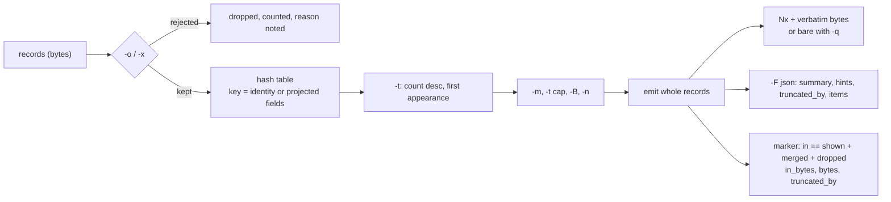

`brief` (patch 0014, `src/miscutils/brief.c`) reduces the number of records in line-oriented output and never edits a record. It covers what people reach for a format-specific compressor (rtk) to do, using six orthogonal primitives and caller-supplied structure instead of a per-format registry, and `-F json` returns a view that explains itself to a model that cannot see the input. 910 checks green on darwin-arm64 and in AlmaLinux 9.

## The record model

A **record** is one line, or — with `-R STR` — every line up to the next line containing STR. That one flag makes multi-line output reducible without knowing the format: a commit, a pytest failure block, a stack trace or a `docker build` step becomes one record, so counting, ordering, thresholds, samples and the budget all work on it, and **a record is shown whole or not at all**. Lines before the first match form a prologue record, kept (and dropped as a unit if it cannot fit any budget, rather than emptying the view). A `-R` record is capped at 4 MB so a never-matching pattern cannot buffer the stream.

## Flags

| flag | effect |
|---|---|
| `-o STR` / `-x STR` | selection: show only / drop records containing STR (repeatable, OR) |
| `-R STR` | a record starts at each line containing STR |
| `-c LIST` | group by these fields and show them (the aggregation) |
| `-t N` / `-m N` | keep the N highest-count groups; show only groups seen ≥N times |
| `-f LIST` / `-i SEP` / `-S SEP` | project fields; field separators in (`-i`) and out (`-S`) |
| `-d` / `-s` | group identical / digit-masked records |
| `-q` / `-k STR` | bare records; never merge a record containing STR |
| `-B` / `-n` / `-a` | byte budget, record cap, samples per group |
| `-F json` | the self-describing view, below |

`-t N` is a cap, not only an order: "top" has to mean the first N groups or the counters say 87 groups while the hint says 3.

## `-F json`: a view that explains itself

```
{"schema":1,
 "summary":"456 lines in, 87 records, 5 of 87 shown, 137 of 36000 body bytes, incomplete",
 "pct_of_input":0.4,
 "hints":["-t kept the 5 highest-count groups of 87: raise -t for the rest"],
 "truncated_by":"top",
 "lines_in":456,"records":87,"matched":456,"lines_shown":5,"lines_merged":151,
 "dropped_records":82,"dropped_lines":300,"bytes":137,"in_bytes":36000,
 "truncated":true,"shown_groups":5,"projected":5,"top":5,"min_count":1,
 "grouped_by":"1","record_start":null,
 "items":[{"n":70,"lines":70,"kept":false,"f":["src/libbb/xfuncs_printf.c"],
           "line":"src/libbb/xfuncs_printf.c"}, …]}
```

Four things make this readable by a model rather than merely parseable:

* **`summary`** — one sentence: how much came in, how much is shown, and whether the view is complete. It is the first thing to read and the thing to quote.
* **`hints`** — computed, never canned: each hint names the flag that would change the answer (`raise -B`, `raise -t`, `lower -m`, `-o` is a substring not a regex). A complete view with nothing merged emits `[]`.
* **`truncated_by`** — `null | selection | records | min_count | top | record_size | budget`. "truncated: true" does not tell a reader which flag to change; this does. The text marker carries the same word.
* **items** — one object per group, not per sample: `n` is the count, `lines` the total lines across occurrences, `line` the record bytes **without** the `Nx ` rendering prefix and without a trailing newline (the count is already a field), `f` the selected fields as an array so nothing has to be re-split, and `samples` only when `-a` showed more than one. Newlines are `\n`, not `\u000a`.

An example of a section: `{"n":1,"lines":3,"kept":false,"line":"commit aaa\nAuthor: X\n    one"}`.

## Measured against rtk on the same input

| case | input | rtk | brief |
|---|---|---|---|
| `git log -30` | 18,918 B | `rtk git log` 9,672 B, lossy digest | `-R 'commit ' -B 2000` **2,020 B**, whole commits, byte-exact |
| pytest log | 17,137 B | `rtk log` 644 B (counts only), `rtk err` 772 B | `-o FAILED` **618 B** (the six failures); `-R '____' -B 900` 1,005 B (four whole blocks with code) |
| `grep -rn error src/libbb` | 36,000 B | `rtk rg` 14,361 B | `-i : -c 1 -t 20` **766 B** (top 20 files by match count) |
| `ls -l src/libbb` | 11,129 B | `rtk ls` 779 B, 52 of 174 entries silently | `-q -f 9 -B 800` 999 B, 54 entries **and `truncated=1`**; unbounded it prints all 174 |
| wall time | — | `rtk ls` median 70.5 ms | `ls -l \| brief` median 35.7 ms |

The two smaller rtk numbers are the two lossy ones: `rtk log` prints a count and no messages, `rtk ls` drops 70% of the entries without saying so.

## The idioms that replace rtk subcommands

| what you used rtk for | brief |
|---|---|
| `rtk git log` | `git log \| brief -R 'commit ' -B 3000` |
| `rtk err CMD` | `CMD 2>&1 \| brief -o error -o warning -o fatal` |
| `rtk test` failures | `pytest 2>&1 \| brief -o FAILED` or `-R '____' -B 3000` |
| `rtk rg PATTERN` | `grep -rn PAT \| brief -i : -c 1 -t 20` |
| `rtk ls` | `ls -l \| brief -q -f 9 -B 2000` (add `-d -s` for counts) |
| `rtk log` | `brief -o error -s -t 10` (and it keeps the messages) |
| `rtk gain` | the marker's `in_bytes=`/`bytes=`, or `-F json` — per call, no ledger file |
| `rtk json` | `busybox json` (patch 0010) `\| brief -d` |

## Cost and tests

`brief.o` 8,264 → 18,632 B; `__text` +3,680 B and `__cstring` +1,023 B, i.e. +5,231 B of `__TEXT` content for everything added in this tranche. The stripped file moves 889,840 → 906,384 B (+1.86%) because the text section crossed a 16 KB page; the budget is 5% of the binary, so it is inside. `./tests/brief.sh <busybox>`: 910 checks (41 sections), including the invariant across 33 option sets on three binary corpora.


