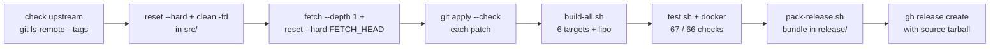

Cutting a busybox-static release is `./build-all.sh && ./pack-release.sh && gh release create`, but four steps around it are easy to get wrong. The full runbook is [`RELEASING.md`](../RELEASING.md); this is the short version plus the traps.

## Traps

**`git describe` fails.** `src/` is a shallow clone with zero tags, so version detection must use `git ls-remote --tags --sort=v:refname` (tags look like `1_38_0`, tarballs like `busybox-1.38.0.tar.bz2`).

**`git checkout FETCH_HEAD` keeps local modifications.** The applied patches survive the bump, so the next `git apply` dies with `error: libbb/mntent.c: already exists in working directory`. Always `git reset --hard -q && git clean -fdq` before fetching.

**Never `git archive HEAD` for the source tarball.** The patches are uncommitted and `libbb/mntent.c` is untracked, so an archive of HEAD is unpatched source — precisely the GPLv2 violation to avoid. `pack-release.sh` tars the working tree instead.

**`grep -c` returns 1 on zero matches**, which under `set -e`/pipefail kills scripts at exactly the static-ELF success case (0 `NEEDED`). Guard with `|| true`.

## Prerequisites that bite later

`rob-c/busybox-static` did not exist; `gh` was authenticated as `rob-c` with `repo` scope, so `gh repo create --public --source=. --push` is step 0. Keep `src/`, `build/`, `dist/`, `release/` git-ignored — verified with `git check-ignore` that a 50 MB upstream clone stays out.

Each release must attach the patched source tarball, the `.config` per target, and the patch files, because busybox is GPLv2-only.
