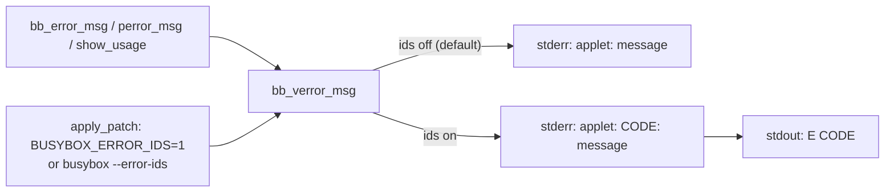

`BUSYBOX_ERROR_IDS=1` (or `busybox --error-ids APPLET ARGS...`, or `run --error-ids -- ...`) makes every diagnostic print twice: the **id alone on stdout** and the **same message on stderr with the id in front**. With the switch off nothing changes — the id path is one `getenv` on an error path that was already printing, so a normal direct invocation is byte-identical, which `tests/streams.sh` asserts.

```sh
$ busybox cat /nope                       # unchanged
cat: can't open '/nope': No such file or directory

$ busybox --error-ids cat /nope           # stdout | stderr
E NOT_FOUND
cat: NOT_FOUND: can't open '/nope': No such file or directory
```

## One choke point, no per-applet registry

`bb_verror_msg()` (`libbb/verror_msg.c`) is what every `bb_error_msg`, `bb_simple_error_msg`, `bb_perror_msg` and `bb_info_msg` ends up in. In ids mode it formats once, writes stderr with the code spliced after `applet: `, then writes `"<channel> <code>\n"` to stdout. No applet changes are needed for the common case.

| where the code comes from | example |
|---|---|
| `bb_error_code` set by an applet | the extension point for exact codes |
| errno captured by `bb_perror_msg*` into `bb_perror_errno` | `ENOENT`→`NOT_FOUND`, `EACCES`/`EPERM`→`PERMISSION`, `EISDIR`→`IS_DIR`, `ESRCH`→`NOT_FOUND`, `ENOSPC`→`NO_SPACE`, `ETIMEDOUT`→`TIMEOUT`, `ENOSYS`/`EOPNOTSUPP`→`UNSUPPORTED`, and a dozen more; unmapped errno → `FAILED` |
| `bb_show_usage()` | `E USAGE`, emitted once for the usage error after the text, and only when `xfunc_error_retval` is set (so `--help` gets no id) |

Channels: `E` for a diagnostic, `W` when the formatted message opens with `warning` (10 such call sites today), with code `WARN` when no errno explains it. Applets that answer with JSON (`peek --format json`, `run -F json`, …) keep their `code` inside the object and emit no id line, so a caller never sees the same error twice.

## `run --error-ids`

`run` is where this is most useful: it already separates the child's streams and stores both artifacts, so the id set and the messages land in different files by construction.

```sh
$ busybox run --error-ids -- busybox cat /nope
--- stdout ---
E NOT_FOUND
--- stderr ---
cat: NOT_FOUND: can't open '/nope': No such file or directory

$ busybox run --error-ids -F json -- sh -c 'busybox cat /nope; busybox cat /etc' | jq -c .codes
["E NOT_FOUND","E IS_DIR"]
```

`codes` appears in the JSON only when the flag was given (shape-matched `^[EWI] [A-Z_]+$`, deduped, capped at 8), so existing parsers of `run --format json` see no change. The flag is implemented in the same argv pre-pass as `-e/--env`: it appends `BUSYBOX_ERROR_IDS=1` to the child's environment. It only affects children that read it — a busybox applet, never a system tool.

## The sweep that justifies "all errors on stderr"

`tests/streams.sh` runs every applet with an argument it must reject and requires stdout to be empty: **256 applets on darwin-arm64, 388 on the aarch64 Linux build, one violation found** (`runlevel` printed `unknown` to stdout while exiting 1; fixed in patch 0015). The same file asserts the ids behaviour, the unchanged default, and the errno→code mapping — 37 checks, 4 s.


